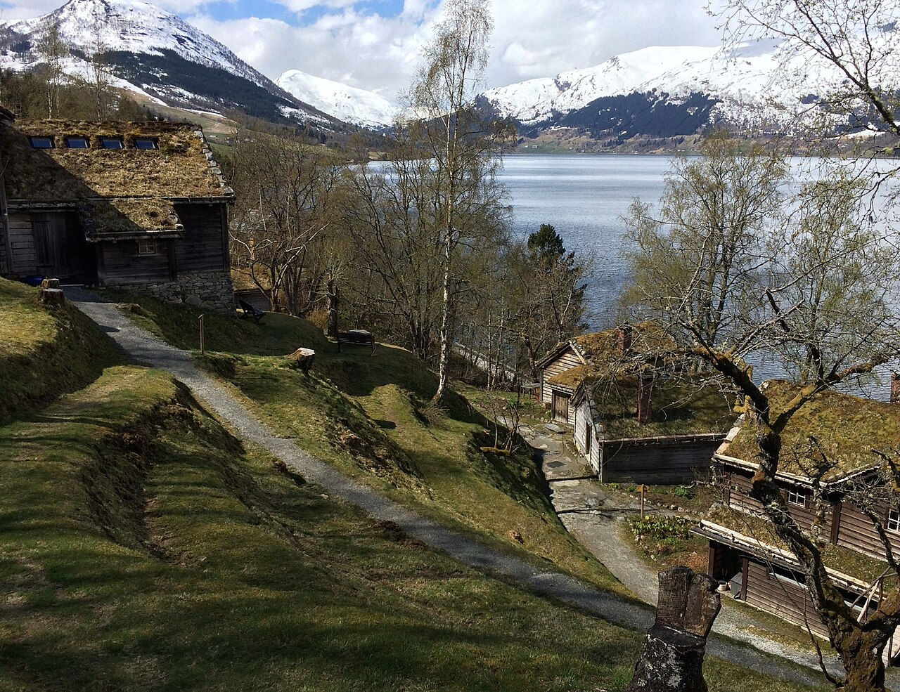
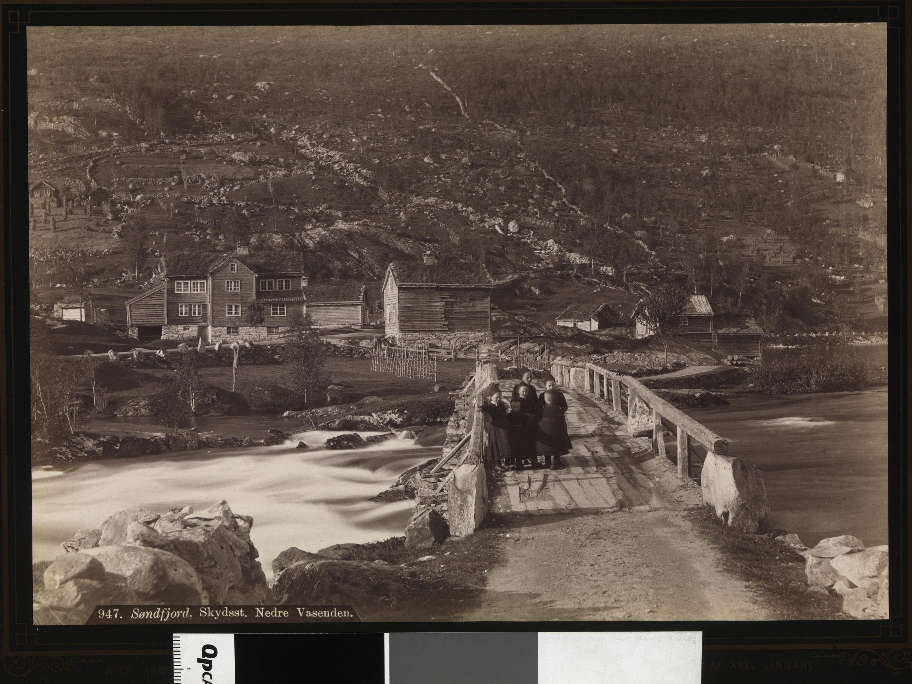

# 跨湖庄园：历史与建筑真实参考

整理日期：2026-11-02。配合[跨湖庄园历史母设定](../../../设定/核心/跨湖庄园_发展史与空间分工.md)使用；完整文献核验见[研究记录](../../../log/全仓-庄园原著描述梳理/跨湖庄园发展史_文献核验与旧图改造评估_20261102.md)。

本索引收真实照片、档案图与官方图文入口；不把生成概念图当作史料。各参考只借用表中指定部分，不整套复制现实地产。

## 已有本地照片

### P01：Jølster 湖岸农庄与坡地

- [本地图片](../../小镇/真实参考/Astruptunet-湖岸农庄-20150506.jpg)
- 作者：Wolfmann；2015-05-06；CC BY-SA 4.0。
- 来源：<https://commons.wikimedia.org/wiki/File:Astruptunet_Jølstravatnet_Norway_2015-05-06_10.JPG>
- 本地状态：既有1280px参考版本，沿用原来源清单；不重复拷贝。
- 用途：木构小体量、不同用途建筑、湖岸与园地关系。不能将真实陡坡及其风险照搬成本作住宅地块，也不能用普通农庄体量代替南岸大宅。

### P02：Vassenden，19世纪末的地方建筑与交通环境

- [本地图片](../../小镇/真实参考/Vassenden-历史-1880年代.jpg)
- 摄影：Axel Lindahl；约1880—1890年；挪威国家图书馆数字化；公有领域。
- 来源：<https://commons.wikimedia.org/wiki/File:947._Søndfjord,_Skydsst._Nedre_Vasenden_-_no-nb_digifoto_20160104_00029_bldsa_AL0947.jpg>
- 本地状态：已有入库版；详细元数据沿用`视觉/小镇/真实参考/sources.json`。
- 用途：谷地、交通节点、坡屋顶与老建筑群的实际比例；帮助北岸院落摆脱“标准化景区小木屋”印象。不是本作庄园的老照片。

## 新找到的外部图像参考

以下链接已随来源页面核验；当前尚无本地图片副本。执行环境直连下载`kringom.no`时DNS失败，因此不声明已下载。

### P03：Leikanger旧官邸——南岸主楼比例优先参考

- [来源与历史说明](https://kringom.no/nb/indre-sogn/sogndal/sorenskrivargarden-i-leikanger)
- [图片直链](https://kringom.no/sites/default/files/styles/article_full/public/uploaded/mediaFiles/9222/sfff-100057111514.jpg?itok=9cEF75Rp)
- 摄影：Hermund Kleppa；2002；藏于Fylkesarkivet i Sogn og Fjordane。
- 页面明确许可：[CC BY-SA 3.0 Norway](https://creativecommons.org/licenses/by-sa/3.0/no/)。下载、引用及改作时保留署名与许可要求。
- 用途：两层木构主体、中央与双翼比例、克制木作、分期扩建；借用建筑语言，不借用前景现代道路和全部精确尺寸。

### P04：Bruland旧官邸——北岸经营院落

- [官方地方史图文及历史照片](https://kringom.no/nb/sunnfjord/sunnfjord/futegarden-pa-bruland)
- 页面包含约1994年主屋、1988年院落、约1927年人群历史照等图片，逐张摄影者和收藏者不同；不将页面首图或整组照片一概标成CC许可。
- 用途：旧住宅、账房、仓储与生产院落如何形成复杂整体；北岸建筑群的历史身份。主屋18世纪风格不自动移植给19世纪南岸主楼。
- 状态：来源链接；具体照片未下载，复用许可须逐张核对。

### P05：Alvøen——富裕住宅、服务建筑和多代花园

- [博物馆官方入口与图文](https://bymuseet.no/museum/alvoen-hovedbygning/)
- [官方花园历史与图文](https://bymuseet.no/alvoen-hage/)
- [外观图片入口（SNL）](https://snl.no/Alv%C3%B8en)
- 用途：西挪威富裕家庭的木构住宅、主从建筑区别、花园和林地的长期累积。园林与住宅的开放方式供功能研究，工厂不移植到本作小湖。
- 状态：链接参考；不以网站整体版权说明推断照片可自由复用，未下载。

### P06：Bogstad——湖景、园路与不同花园时代

- [园林官方图文](https://bogstad.no/parken)
- [地产官方历史](https://bogstad.no/bogstads-historie)
- 用途：湖岸花园、曲线路径、成片大树、近宅正式花园与自然式园林的区别；不借用奥斯陆地区地形作为Jølster的地貌证据。
- 状态：检索到官方图文入口，直接文本抓取403；未下载。图片授权需逐张确认。

### P07：Rosendal——收藏层次；Gamlehaugen——公园与现代服务分区

- [Rosendal官方历史和档案图](https://www.baroniet.no/en/history/)
- [Riksantikvaren关于Rosendal的建筑与庭园图文](https://riksantikvaren.no/stormfulle-dalstrok-baroniet-i-rosendal/?p=32604)
- [Statsbygg的Gamlehaugen图文](https://www.statsbygg.no/eiendom/gamlehaugen/)
- 用途：Rosendal看多代家具与收藏，不将其1665年石砌外壳当南岸1856年木宅；Gamlehaugen看功能与园路，不借塔楼和城堡轮廓。
- 状态：来源链接；未下载，不作为已获授权可直接发布的图包。

## 使用优先级

南岸外壳优先P03，北岸院落优先P04与本地P01/P02，西岸园路优先P05/P06，室内历史层次补看P05/P07。先按同一四岸总图组织建筑，再选取相应视角；不要把不同地产的前景、朝向和尺度拼成看似写实却不一致的总图。
