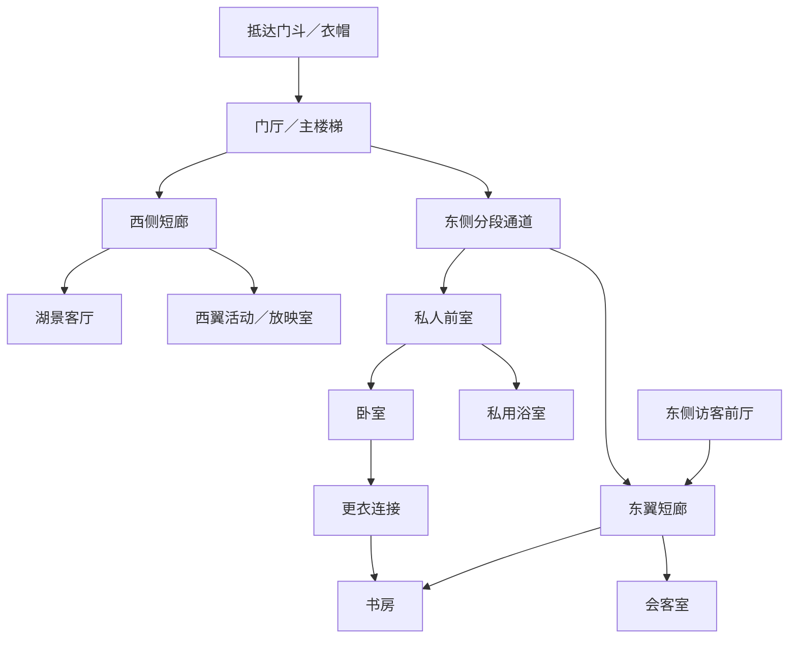

# 南岸主楼全屋房间拓扑 · 讨论稿

> **已被2026-11-05用户确认的定稿替代。** 当前空间关系以[“草台班子”定稿包](主楼草台班子_定稿/README.md)为准；本文件仅保留早期讨论史。尤其“客厅绕西廊进门、南墙智慧屏、家庭活动室兼放映室、主楼梯下餐厅、坎特不住主楼”等旧方案均不再作本楼依据。

日期：2026-11-05。范围：南岸罗辑住所，含中央主体、东翼、西翼及后加服务体量。状态：供讨论的房间邻接与通行方案，不是已验证可施工的平面；不覆盖既有用户决定，不据此改正文或重画三张室内图。

## 依据与优先顺序

已对照客厅、卧室、书房三份HTML、配套说明及PNG，读取当前历史母设定、别墅区分补节与42-L、38-L等正文。三份HTML是家具和走位参考，各自尺寸与建筑级落位需要统一验证。优先保留用户确定的关系：

- 罗辑卧室在中央主体东端1层；书房在东翼二层，与之同一标高。
- 卧室西邻客厅，共用壁炉／烟道墙但不开门；卧室南门接走廊。
- 卧室经东南楔形更衣空间通书房；书房南门接东翼走廊；东邻会客室。
- 客厅保留临湖窗、可开启的露台窗及西侧入口；书房北侧湖景和书架事故走位保留。
- 东北旧别墅的客房、西翼小起居室、资料归档室及20-L餐厅不搬回本楼。东岸宴会厅与中央厨房仍独立；主楼只保留家庭餐厨。

母设定§4仍有“客厅朝南、露台搬南面”的旧段落，与三张图及同文后续朝向条目冲突。本稿按北侧湖景客厅、南侧入口与辅助空间处理，列为待统一项。旧交接“主客厅在下层”只表示其上还有一层，不据此强定客厅在−1层。

## 住宅组织原则与真实参考

借用的是挪威富裕住宅的生活和服务组织，不直接复制某个时代或建筑的全部平面：入口换衣、防风；会客与家人私室分开；后勤入口、备餐、储藏与服务楼梯连贯；浴室、洗衣与设备属于后期现代化层，不假定1856年已有今日配置。

1. Riksantikvaren：《Villa Stenersen — Dokumentasjon》（保护档案）。印刷页6记载业主与服务人员两套楼梯，储藏、洗衣、锅炉、厨房与备餐空间构成经济服务区；页11—12记载卧室走廊、浴室及主卧更衣区。借用分流和湿区组织；该宅为1930年代现代主义建筑，不据此推定本作1850年代木宅的造型、结构与原始配置。
   https://riksantikvaren.no/content/uploads/2020/11/Villa-Stenersen-Dokumentasjon.pdf
2. Norsk Folkemuseum：《Et dukkehjem – 1879》。博物馆复原住宅包含办公室、餐厅、沙龙、走廊、厨房、食物储藏与女佣房；借用独立房间及餐厨后勤关系。它是城市住宅及复原展示，不代表所有挪威乡间宅邸同一种布局。网页搜索索引可读，直接访问返回403，未据此核验原始平面。
   https://norskfolkemuseum.no/et-dukkehjem-1879
3. Norsk Folkemuseum：《Bolighus fra Olderfjord》。房间清单有vindfang、gang、kjøkken、kammers、stue，支持入口缓冲与内部厅室分层这一功能思路；该实例是战后北挪威住房，不是19世纪西挪威庄园的直接历史原型。直接访问返回403，仅采用已检索到的清单。
   https://norskfolkemuseum.no/bolighus-fra-olderfjord

以下房间的具体数量、落位、邻接均是本作设计建议，不能说成真实挪威房屋的固定标准。

## 三层与分期体量

| 统一设计编号 | 中央主体 | 东翼 | 西翼／后加部分 |
|---|---|---|---|
| −1：临湖下层 | 主楼梯下厅、临湖家庭餐厅；其余下层随实际地形限定 | 小厨房、洗碗、日用食物储藏、旧冰窖分隔保留、服务楼梯 | 仅在实际露明且有净高处安排小洗衣与储物、设备；不把全西翼铺满假定地下室 |
| 1：陆侧入口层 | 门厅与主楼梯、湖景客厅、东端罗辑卧室、陆侧画室及私用前室／浴室 | 楔形更衣连接、书房、隔壁会客室及访客前厅；东翼自旧场院侧数为二层 | 西翼家庭活动／放映室；后部服务入口、茶水备餐位、家政储物 |
| 2：中央主体上层 | 上层走廊与湖景窗、阅读／手工房、备用卧室与共用浴室 | 不默认再叠一个“东翼三层” | 西翼若确认有上层，可容纳备用居室；数量由体量确定 |

主楼1层是主要生活层，绝非只有卧室的整层寝宫。主客厅、卧室、书房同层可正常成立。2层仍真实使用，容纳阅读／手工房与备用居室，不必为了“楼上”的叙述把主卧迁移。保留两间备用居室作为第一轮功能配额；最终可随体量缩减，不预设一排酒店客房。固定访客住宿仍优先东北旧别墅。

## 1层：具体邻接

本节的东西南北用于房间关系；东翼斜置需转换为其自身局部坐标，以下不是将所有墙强行画成平行。

### 中央入口与客厅

- 南／西南抵达庭院 → 有顶门廊 → 防风门斗（vindfang）→ 脱外套、换鞋与放伞的衣帽位 → 中央门厅。
- 门厅邻近客用WC、主楼梯；WC经小前室开门，不直接朝餐桌或客厅座席。
- 门厅向北转入客厅西侧短廊，再由现有西门进客厅；西侧短廊也可向西翼延续。不开一条穿过沙发与茶几的全楼公共通道。
- 客厅北面是湖景露台，东墙是与卧室相邻的实体壁炉墙，南墙保留智慧屏；不为凑中轴而强开南门。
- 门厅一侧留普通储物、衣帽及清洁柜。南侧不必是一条占满整面采光的狭长走廊，可由门厅、短廊和小前厅串联。

### 东侧私人套间

- 门厅 → 可关门的私人短廊／前室 → 卧室南门；访客不会直接对着床。
- 私用浴室从私人前室或更衣区进入，内含WC、洗手盆与淋浴；浴缸可选。浴室优先放卧室南侧较深的陆侧区域，而非占北侧湖景窗。
- 常用画室安排1层陆侧、从主楼梯到卧室的私人通道沿途，门外不占更衣间通路。42-L饭后上楼、经过画室、再回卧室因而能在同一层完成；“走过两扇门”可由浴室、布草／储物等门位协调，最终数量需平面实排。画室应有真实外窗及储放画具的位置，南向光可用窗帘柔化，不强求把每个创作空间都塞到湖景北面。
- 卧室东门 → 更衣连接空间 → 书房西门，保留用户确定的套间关系。
- 更衣空间属于私人套间，不能成为去会客室、送茶、维修窗帘的必经路；书房另有南门。
- 床头西墙与客厅隔墙保持不开门；壁炉、床头、烟道的实际占位仍须剖面检查。“共烟道墙”不代表两座壁炉共用一个排烟孔。

### 东翼书房与会客

- 书房在卧室以东，北面临湖，东墙邻会客室。书房南门接东翼短廊。
- 公共门厅可经南侧通道到东翼短廊，绕过私人前室；住户也能从卧室经更衣间进书房。
- 会客室从东翼短廊进。最初可不加书房与会客室的直通门，避免随意破坏书房东墙壁炉位置；“隔壁”只要求相邻，不要求彼此开门。
- 东／东南另有访客门斗、等候／衣帽小前厅与访客WC，接会客室和东翼短廊。获准来访者可直接入会客室，必要时经短廊进书房，不经过卧室前室。
- 东翼接轨／公路的室外标高为现有工作设定，实地坪需复核；不把访客门画在旧码头水面上。

### 西翼与服务后部

- 西侧短廊 → 家庭活动室兼放映室，保留正常外窗并可遮光；不必单建影院大厅。该房与东北别墅24-L小起居室不是一间。
- 放映设备放房内柜体或相邻壁柜，不虚增专门机房；片库终端可接现有服务系统。
- 南／东南后部服务门 → 工作衣帽与湿鞋缓冲 → 服务前厅 → 东侧服务楼梯、茶水／备餐位、家政柜。
- 备餐位只放水槽、小冰箱、茶咖啡与餐具，服务客厅、书房、会客室；实际煮面与做早餐仍在−1小厨房。
- 坎特可在服务前厅旁有小办公／值班工作间，不据此认定他必须住主楼。员工固定住宿与集中用餐继续在既有其他区域。

## −1层：生活下层，不全当作阴湿地下室

| 房间／区域 | 必须连接 | 不宜的关系 |
|---|---|---|
| 主楼梯下厅 | 家庭餐厅、下层短廊、临湖外门 | 家人去餐厅不应穿设备间或洗碗区 |
| 临湖家庭餐厅（约4—8人日常桌） | 下厅、厨房／备餐门、临湖窗；有条件时接低台地 | 不承担全庄园员工食堂与60-DL大宴会 |
| 小厨房 | 餐厅、洗碗／日用储藏、服务楼梯 | 员工进出不必经过餐桌；不放大成第二套中央厨房 |
| 洗碗与日用食物储藏 | 小厨房；功能可合并为邻接工作带 | 清洁餐具与生活垃圾不在唯一狭门上互相堵塞 |
| 旧冰窖 | 厨房附近，经缓冲／储藏通道联系 | 历史低温空间与今日食品冷藏设备分开；不让潮气直入居室 |
| 小洗衣／家政间 | 服务通道、布草柜，方便上下送换洗物 | 工业洗衣不进主楼；不贴放映室或床头布置噪声设备 |
| 设备间 | 服务通道或独立维护外门 | 优先远离卧室与画作储存；外墙散热、检修空间待定 |
| 普通储藏／季节用品 | 服务通道 | 不能把贴土潮湿的角落直接称艺术品恒温库 |

主楼梯负责住户上下餐厅与上层；东侧服务楼梯负责餐食、布草和设备维护。第一版不默认增设客梯或货梯，后续确有运输／使用需求再加，避免空间无依据膨胀。下层外门落在高于高水位的干燥低台地，码头更低、另有坡阶连接。

## 2层：上层居室与备用活动空间

- 主楼梯 → 有可挂纸星的临湖窗的上层楼梯厅／走廊；不是把楼梯厅塞在完全无窗的屋心。
- 上层走廊分别开门到两间备用居室、阅读／手工房、共用浴室与布草柜；各居室独立出入。
- 常用画室留1层，以满足42-L饭后上楼后经过画室再回主卧的顺序；2层可保留历史家庭活动用途，不新增第二间必需画室。
- 备用房可沿用历史家庭卧室／儿童房的尺度与门窗，后来改为住客可用房；房间用途可随入住状态变化。
- 浴室尽量靠下层湿区与管井叠置；不为整齐而让排水管横穿书架顶或客厅天花。
- 不在住宅内另设大型收藏库、独立档案中心或全员办公区；既有北岸和别墅已承担这些功能。

## 门与通路关系图（连接图，非平面）

图中箭头只表示可以通行，不表示单向门或精确方位；主楼梯的上下层连接及服务线路见下列矩阵。

| 路线 | 通行顺序 |
|---|---|
| 主人回家 | 门斗—衣帽—门厅—私人前室—卧室 |
| 主人去书房 | 卧室—更衣连接—书房；另可经私人前室／通道—书房南门 |
| 普通家访 | 门斗—门厅—客厅；访客WC在门厅旁 |
| 约定会谈 | 东侧访客门斗—前厅—东翼短廊—会客室；需要时去书房 |
| 早餐 | 1层卧室—私人前室—通道—门厅主楼梯—−1下厅—家庭餐厅 |
| 送茶／收拾 | 服务前厅—茶水位—东翼短廊／门厅—会客室或客厅；不穿卧室 |
| 采购与食品 | 后部服务入口—服务楼梯—−1储藏／厨房；上桌直接进旁边餐厅 |
| 饭后回房 | −1餐厅—主楼梯—1层通道—卧室；途中可停1层陆侧画室 |
| 上层活动 | 主楼梯—2层走廊—阅读／手工房或备用居室；各房独立开门 |
| 设备检修 | 服务门／独立维护门—设备区，尽量不经过住户室内 |

## 三张图为什么现在难拼，下一轮应如何处理

1. **进深不等**：客厅7.4m、卧室5.0m、书房7.2m，若临湖北端对齐，南墙并不在同一线上。这并非不能盖，而是不能把三张图的南边都直接认作同一条笔直走廊。采用分段通道与私人前室，利用卧室后方凹入区域布置部分浴室／更衣；这些仍需实际平面证明能装下。
2. **客厅西门**：门厅应接客厅西侧短廊，而非把入口直接放客厅正南，再对着智慧屏强行穿门。
3. **楔形更衣**：现图南端最大深度约1.3m，扣柜后部分净通道仅0.4—0.7m，无法作为舒适的两人常用套间连接。保留楔形构想，尖端只作浅柜／封闭空腔；在宽端增加一块可正常行走的前室，或局部调整主体与翼楼接口，不把尖角全当作可站人的衣帽间。先按柜前约0.9—1.0m净通行作试排目标，含柜总宽通常需约1.5—1.7m；这些是设计目标，不是法规合格结论，且门扇开启还要另外核验。
4. **书房西门位置不一致**：HTML／PNG仍写“西墙中段直通卧室”，最新说明改成经更衣间；卧室楔形连接又偏南端。下一版需在同一坐标图中选定连接段，再重排书架；保留靠窗梯子与地毯事故位，优先动南段家具和门位。
5. **缺生活配套**：三张房间图没给出私用浴室、门斗、衣帽、客卫、楼梯、家政与储物的占地。必须先为它们留位置，剩余外轮廓才是主楼尺寸。
6. **层高和烟道**：主楼1层与东翼二层虽约定同高，楼板、屋顶、烟道仍需剖面验证。共同壁炉墙也不能绕过床头、炉前空间和排烟的实际占位问题。
7. **年代与现代化**：入口与厅室保留旧木宅逻辑；浴室、设备、洗衣及现代厨房按20世纪改造解释，优先借后部服务体量，不把全屋画成1856年已配齐套卫的现代豪宅。

## 正文动线复核与剩余问题

- 01—02：客厅转书房可经门厅与东侧通道，不必穿卧室；房间大小关系保留。
- 16-L：工程师在东翼走廊测试窗帘，进出书房南门，与卧室私用连接分开；会客室相邻。
- 27-L：敲卧室南门；去餐厅可下主楼梯。小厨房在餐厅旁，不用端着面跨层上桌。
- 38-L：客厅纸星在1层，第二颗在2层走廊湖景窗；书房与客厅同层，因此“离开书房、经过客厅”可理解为经过客厅门外短廊或转入客厅关灯。当前客厅只有西侧室内门，不能画成从书房直接穿客厅回卧室的双门捷径。
- 42-L：早饭时她从楼上拿画册下来，餐厅在−1层即可承接；晚饭后回1层亦属上楼。常用画室安排1层私人通道沿途，使“到画室门口—再走过两扇门回房”可在同层完成；具体门的数量及视线交由平面实排。开篇挂画所在的上层走廊也有2层可用，不必将所有“楼上”解释成同一绝对层号。
- 24-L：小起居室、客房与写生草地已归东北别墅，本楼无须再复制同组场景。

**建议下一步**：先画1层无家具分区图，并同时画−1与1层穿过餐厨／卧室接口的剖面；逐项检验门窗、净通道和房间进深，再回改三张室内图。优先用房间和通道的调整消除矛盾，正文仅在无法合理落位时另提修订，不悄悄改用户已经定下的门与邻接。
