# “草台班子”主楼：房间轮廓与 Agent 交接

版本：2026-11-05-v1。状态：用户已确认本版拓扑与粗轮廓；家具、门窗细节及构造尚待各房间设计。

本文件与[JSON坐标](房间轮廓数据.json)、[轮廓图册](所有房间_轮廓图册.html)、[三维定稿](主楼草台班子_三维拓扑定稿.html)由同一份已确认白模导出。正文未改。主楼别名采用“草台班子”；罗辑命名的正文桥段尚未创作。

## 给接手 Agent 的执行口径

1. 先读本文件中的目标房间及相邻通路，再读原单间 `.md/.html` 的正文走位。不要拿旧单间图反向覆盖本版外轮廓。
2. 可以改家具、饰面、机位、窗扇分格与门扇方向；保持全屋相邻关系、房间粗外形、已确认通行与隐私边界。门位坐标是白模工作值，可为单间使用微调，但须同步相邻房间。
3. `vertices_world_xz_m` 是全屋坐标，X东、Z南；`vertices_local_m` 是本翼刚性展开后的米制坐标。P1..Pn按数组顺序闭合。东西两翼不可简单按全局包围盒画成长方形。
4. 尺寸为墙线轮廓，非净空；不要把剖低墙1.05m当真实墙高。西翼生成器v为分段布局参数，实际房间尺寸以本册边长/顶点为准。
5. 下列D编号为当前白模门洞/开放接头，无门扇、无门禁含义。窗位除剧情锚点外尚未锁定。OUTSIDE_OR_UNMODELED只表示该门未与另一个室内轮廓配对，不自动证明它开向室外。
6. 不在本轮重画房间的同时改正文、庄园总图或给其他建筑重新分配场景。

烟囱预留更新：本版含C1–C4及C6占位，C5取消；C6上下层分别服务厨房、书房和会客室。C3旁设备间落实为旧锅炉房／供热机房，老人房与餐厅使用水暖。详见[核心与接入说明](烟囱核心与房间接入预留.md)。卧室入口新试排尚未同步本轮廓包，不能由旧矩形轮廓覆盖其试排图。

## 优先修改的三张旧图

| 原图 | 本版房间 | 必须同步的主要变化 |
|---|---|---|
| 主楼客厅布局俯视图.html | L1-01 | 扩至约8.4×7.4m；南门直接接门厅，西侧接梯形画室（原家庭起居室）；智慧屏移西墙北段，沙发需重排；北窗和露台保留。 |
| 卧室布局俯视图.html | L1-02 | 约3.4×5.0m矩形；西墙不开门，南门经小过厅接通路，东门接扩大后的更衣连接间；床位/充电道具依旧图与正文。 |
| 书房布局俯视图.html | L1-04 | 约4.6×7.2m，东翼局部矩形；东墙西移0.6m，与东移后的C6对齐；西门经更衣连接间入卧室，南门接东翼走廊；北窗、书架取画册与梯子事故走位保留。 |

## 已冻结的全屋关系

- 主体朝南北，北侧临湖；坡面南高北低。中央主体下方是实心地基，不再挖地下房间。
- 主客厅、卧室、书房在同一主生活层。东翼“二层”是从旧码头场院侧数，等于主体一层。
- 西翼整体内折约10°，内部矩形房带；只有家庭起居室梯形贴回主体。唯一贯通走廊接主楼南侧短过厅。
- 老人房属于主人空间，只从走廊进入；私用浴室正对面。主佣无硬阻断，佣人自用生活范围在偏西部分。
- 坎特独立一间；1层保留一间女仆房，原−1层女仆房改为锅炉工房／值守卧室，居住与机器操作分开。
- 后代把代步车库加在旧佣人入口前，后加放映厅接西端；主人取车、观影反向借用佣人生活通路，无额外主人长廊或观影棚架。
- 放映厅是连续挑空：1层观影/投影平台，银幕向下跨至−1层，低台通过维护门接库房。
- 东翼−1按南—中—北分带：南埋土地窖，中段西厨房/东杂物，北为较大餐厅。B梯靠主体一端，主人不穿操作区入餐厅。
- 后勤步道接餐厅新西北外门，再从餐厅南门到厨房；东侧旧平院保留平进平出，后加收货间、卸货边和皮卡棚。
- 旧别墅的24-L小起居室、20-L餐厅、客房和归档室不搬进本楼。中央厨房与员工餐厅仍在东岸。

## 轮廓总表

| 编号 | 名称 | 楼层 | 形状 | 局部外包宽×深m | 墙线面积㎡ |
|---|---|---|---|---|---|
| L1-01 | 主客厅 | 1层：主体一层＝东翼二层 | 矩形 | 8.40×7.40 | 62.16 |
| L1-02 | 罗辑卧室 | 1层：主体一层＝东翼二层 | 矩形 | 3.40×5.00 | 17.00 |
| L1-03 | 更衣连接间 | 1层：主体一层＝东翼二层 | 不规则四边形 | 2.86×7.20 | 13.79 |
| L1-04 | 书房 | 1层：主体一层＝东翼二层 | 矩形 | 4.60×7.20 | 33.12 |
| L1-05 | 会客室 | 1层：主体一层＝东翼二层 | 矩形 | 5.40×7.20 | 38.88 |
| L1-06 | 东翼走廊 | 1层：主体一层＝东翼二层 | 矩形 | 10.00×2.00 | 20.00 |
| L1-07 | 转接过厅 | 1层：主体一层＝东翼二层 | 不规则四边形 | 3.38×2.25 | 6.21 |
| L1-08 | 卧室小过厅 | 1层：主体一层＝东翼二层 | 矩形 | 3.40×2.40 | 8.16 |
| L1-09 | 私人走廊 | 1层：主体一层＝东翼二层 | 矩形 | 5.00×1.80 | 9.00 |
| L1-10 | 私人浴室 | 1层：主体一层＝东翼二层 | 矩形 | 3.40×2.90 | 9.86 |
| L1-11 | B 主人餐厅梯 | 1层：主体一层＝东翼二层 | 矩形 | 2.60×3.80 | 9.88 |
| L1-12 | 茶水／备餐间 | 1层：主体一层＝东翼二层 | 矩形 | 2.60×3.80 | 9.88 |
| L1-13 | 访客门斗 | 1层：主体一层＝东翼二层 | 矩形 | 2.20×2.50 | 5.50 |
| L1-14 | 南侧短过厅 | 1层：主体一层＝东翼二层 | 矩形 | 2.20×1.80 | 3.96 |
| L1-15 | 主门厅 · A楼梯 | 1层：主体一层＝东翼二层 | 矩形 | 4.60×3.80 | 17.48 |
| L1-16 | 主入口门斗 | 1层：主体一层＝东翼二层 | 矩形 | 2.80×2.00 | 5.60 |
| L1-17 | 门厅附属间 · 用途待定 | 1层：主体一层＝东翼二层 | 矩形 | 1.80×2.00 | 3.60 |
| L1-18 | 梯形画室 · 原家庭起居室 | 1层：主体一层＝东翼二层 | 梯形 | 5.04×7.29 | 32.07 |
| L1-19 | 老人房 · 主人区 | 1层：主体一层＝东翼二层 | 矩形 | 4.20×7.29 | 30.61 |
| L1-20 | 老人房私用浴室 | 1层：主体一层＝东翼二层 | 矩形 | 4.20×3.15 | 13.24 |
| L1-21 | 主人衣帽／储物 | 1层：主体一层＝东翼二层 | 矩形 | 5.20×3.94 | 20.48 |
| L1-22 | 浴室布草柜间 | 1层：主体一层＝东翼二层 | 矩形 | 4.20×0.79 | 3.31 |
| L1-23 | 坎特房 | 1层：主体一层＝东翼二层 | 矩形 | 3.00×7.29 | 21.86 |
| L1-24 | 女仆房 · 1层 | 1层：主体一层＝东翼二层 | 矩形 | 3.00×7.29 | 21.86 |
| L1-25 | 工作衣帽／布草 | 1层：主体一层＝东翼二层 | 矩形 | 3.00×3.76 | 11.28 |
| L1-26 | C 西侧服务梯 | 1层：主体一层＝东翼二层 | 矩形 | 3.00×3.53 | 10.58 |
| L1-27 | 西翼唯一贯通走廊 | 1层：主体一层＝东翼二层 | 梯形 | 18.56×1.77 | 32.62 |
| L1-28 | 洗衣／家务间 | 1层：主体一层＝东翼二层 | 矩形 | 3.00×3.94 | 11.82 |
| L1-29 | 佣人旧入口／备勤 | 1层：主体一层＝东翼二层 | 矩形 | 3.00×3.94 | 11.82 |
| L1-30 | 佣人浴室／WC | 1层：主体一层＝东翼二层 | 矩形 | 3.00×3.94 | 11.82 |
| L1-31 | 堵在旧门前的车库 | 1层：主体一层＝东翼二层 | 矩形 | 6.20×5.91 | 36.63 |
| B1-01 | 北侧大餐厅 | −1层：临湖下层 | 矩形 | 10.00×7.00 | 70.00 |
| B1-02 | 主人用餐短廊 | −1层：临湖下层 | 矩形 | 1.60×6.70 | 10.72 |
| B1-03 | 中段西 · 厨房 | −1层：临湖下层 | 矩形 | 4.80×4.70 | 22.56 |
| B1-04 | 中段东 · 杂物间 | −1层：临湖下层 | 矩形 | 3.60×4.70 | 16.92 |
| B1-05 | 后侧服务短廊 | −1层：临湖下层 | 矩形 | 8.40×2.00 | 16.80 |
| B1-06 | B 主人餐厅梯 | −1层：临湖下层 | 矩形 | 2.60×3.80 | 9.88 |
| B1-07 | 南侧埋土地窖 | −1层：临湖下层 | 矩形 | 4.80×3.80 | 18.24 |
| B1-08 | 餐具／备餐 | −1层：临湖下层 | 矩形 | 2.60×2.00 | 5.20 |
| B1-09 | 餐厅附属间 · 用途待定 | −1层：临湖下层 | 矩形 | 2.60×1.80 | 4.68 |
| B1-10 | 后加收货间 | −1层：临湖下层 | 矩形 | 2.00×4.70 | 9.40 |
| B1-11 | 季节用品／维修库 | −1层：临湖下层 | 矩形 | 6.00×3.76 | 22.57 |
| B1-12 | 锅炉工房／值守卧室 | −1层：临湖下层 | 矩形 | 3.40×3.76 | 12.79 |
| B1-13 | 下层洗漱／WC | −1层：临湖下层 | 矩形 | 2.00×3.76 | 7.52 |
| B1-14 | 下层布草储藏 | −1层：临湖下层 | 矩形 | 1.80×3.76 | 6.77 |
| B1-15 | C 西侧服务梯 | −1层：临湖下层 | 矩形 | 3.00×3.53 | 10.58 |
| B1-16 | 下层家务前厅 | −1层：临湖下层 | 矩形 | 10.20×1.88 | 19.18 |
| B1-17 | 旧锅炉房／供热机房 | −1层：临湖下层 | 矩形 | 3.40×5.64 | 19.18 |
| L2-01 | 备用卧室一 | 2层：中央主体上层 | 矩形 | 4.00×5.00 | 20.00 |
| L2-02 | 备用卧室二 | 2层：中央主体上层 | 矩形 | 3.90×5.00 | 19.50 |
| L2-03 | 备用卧室三 | 2层：中央主体上层 | 矩形 | 3.90×5.00 | 19.50 |
| L2-04 | 上层短走廊 | 2层：中央主体上层 | 矩形 | 11.80×2.40 | 28.32 |
| L2-05 | 独立浴室 | 2层：中央主体上层 | 矩形 | 2.20×3.80 | 8.36 |
| L2-06 | A 楼梯／家庭厅 | 2层：中央主体上层 | 矩形 | 4.60×3.80 | 17.48 |
| L2-07 | 布草／衣物 | 2层：中央主体上层 | 矩形 | 2.30×3.80 | 8.74 |
| L2-08 | 共用浴室 | 2层：中央主体上层 | 矩形 | 2.70×1.90 | 5.13 |
| L2-09 | 收藏整理 | 2层：中央主体上层 | 矩形 | 2.70×1.90 | 5.13 |
| L1-32 | 定制空调设备间 | 1层：主体一层＝东翼二层 | 矩形 | 3.40×4.43 | 15.07 |
| L1-33 | 小胶片收藏室／放映整备 | 1层：主体一层＝东翼二层 | 6边形 | 5.60×4.43 | 17.43 |
| L1-34 | 独立放映机房 | 1层：主体一层＝东翼二层 | 矩形 | 3.00×2.46 | 7.39 |
| X-01 | 放映厅：连续跨层主空间 | 1层：主体一层＝东翼二层 | 矩形 | 9.00×9.85 | 88.63 |
| X-02 | 放映厅：北端低台 | 1层：主体一层＝东翼二层 | 矩形 | 9.00×1.88 | 16.93 |
| X-03 | 放映厅：1层观影平台 | 1层：主体一层＝东翼二层 | 矩形 | 6.80×2.56 | 17.41 |
| X-04 | 放映厅：观影门斗 | 1层：主体一层＝东翼二层 | 矩形 | 2.20×2.56 | 5.63 |
| Y-01 | 旧码头场院：平进平出 | −1层：临湖下层 | 矩形 | 3.60×6.00 | 21.60 |
| Y-02 | 后加卸货边 | −1层：临湖下层 | 矩形 | 1.60×3.00 | 4.80 |
| Y-03 | 皮卡棚下低坪 | −1层：临湖下层 | 矩形 | 7.00×4.00 | 28.00 |

外包宽深对梯形/不规则房间不等于四边长度；请继续读顶点。影院主空间与子区域面积不可相加，户外区也不计作室内房间。

## 每个房间的轮廓与门洞

### L1-01 主客厅

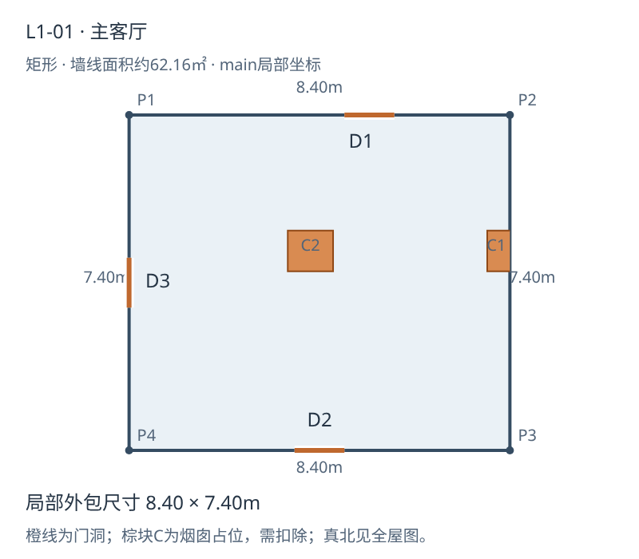

- 楼层：1层：主体一层＝东翼二层；局部框架：`main`；形状：矩形。
- 墙线面积约 62.16㎡；边长依次为 P1-P2=8.400m / P2-P3=7.400m / P3-P4=8.400m / P4-P1=7.400m。
- 局部顶点（米，按P顺序闭合）：P1=(-5.3000, -3.7000)；P2=(3.1000, -3.7000)；P3=(3.1000, 3.7000)；P4=(-5.3000, 3.7000)。
- 全局顶点X/Z（米）：P1=(-5.3000, -3.7000)；P2=(3.1000, -3.7000)；P3=(3.1000, 3.7000)；P4=(-5.3000, 3.7000)。
- 并入原西侧过厅，恢复完整客厅面宽；南门直通主门厅，西门接后加梯形画室（原家庭起居室）。
- 南门由主门厅直接进入；西侧门通梯形画室（原家庭起居室）。
- 北侧湖景窗与通露台的可开启落地窗保留；西墙北段智慧屏，东墙卧室侧不开门。
- 原单间图6.2×7.4m已过时，本版墙线8.4×7.4m。家具、沙发朝向和视距待重排。

| 门洞 | 所在边 | 全局中心X/Z m | 当前宽m | 当前通向 |
|---|---|---|---|---|
| D1 | P1-P2 | 0.000, -3.700 | 1.100 | OUTSIDE_OR_UNMODELED 室外或未建模空间 |
| D2 | P3-P4 | -1.100, 3.700 | 1.100 | L1-15 主门厅 · A楼梯 |
| D3 | P4-P1 | -5.300, 0.000 | 1.100 | L1-18 梯形画室 · 原家庭起居室 |

### L1-02 罗辑卧室

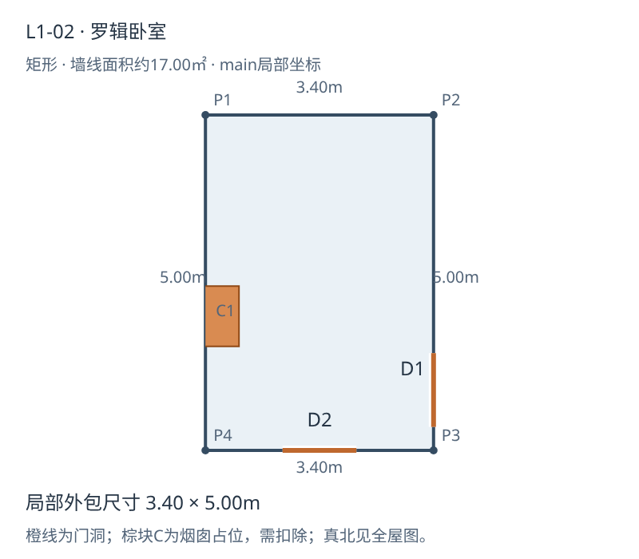

- 楼层：1层：主体一层＝东翼二层；局部框架：`main`；形状：矩形。
- 墙线面积约 17.00㎡；边长依次为 P1-P2=3.400m / P2-P3=5.000m / P3-P4=3.400m / P4-P1=5.000m。
- 局部顶点（米，按P顺序闭合）：P1=(3.1000, -3.7000)；P2=(6.5000, -3.7000)；P3=(6.5000, 1.3000)；P4=(3.1000, 1.3000)。
- 全局顶点X/Z（米）：P1=(3.1000, -3.7000)；P2=(6.5000, -3.7000)；P3=(6.5000, 1.3000)；P4=(3.1000, 1.3000)。
- 南门经小过厅接私人走廊；东门进入更衣连接间。
- 南门通卧室小过厅，东门经更衣连接间进书房；西墙与主客厅共墙不开门。
- 北侧临湖窗保留；旧图床头靠西墙、枕边手机和绕床尾充电走线仍是单间修改依据。

| 门洞 | 所在边 | 全局中心X/Z m | 当前宽m | 当前通向 |
|---|---|---|---|---|
| D1 | P2-P3 | 6.500, 0.400 | 1.100 | L1-03 更衣连接间 |
| D2 | P3-P4 | 4.800, 1.300 | 1.100 | L1-08 卧室小过厅 |

### L1-03 更衣连接间

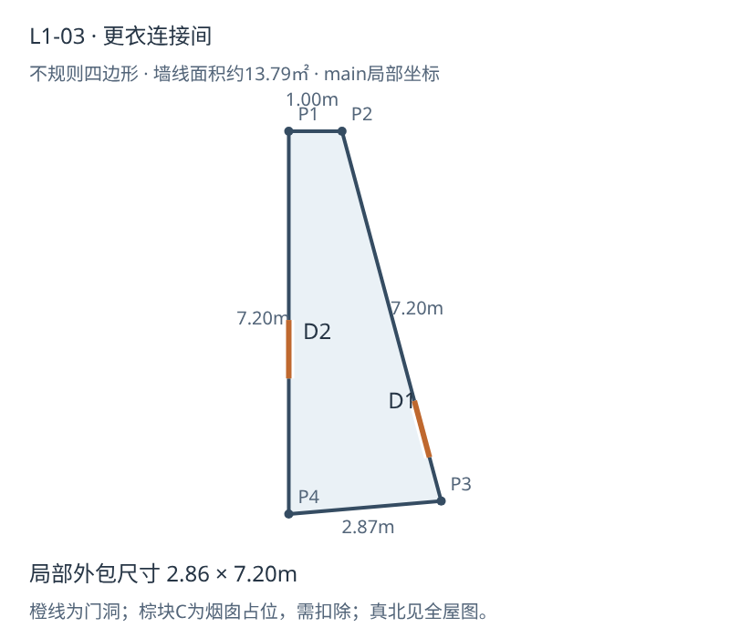

- 楼层：1层：主体一层＝东翼二层；局部框架：`main`；形状：不规则四边形。
- 墙线面积约 13.79㎡；边长依次为 P1-P2=1.000m / P2-P3=7.200m / P3-P4=2.874m / P4-P1=7.200m。
- 局部顶点（米，按P顺序闭合）：P1=(6.5000, -3.7000)；P2=(7.5000, -3.7000)；P3=(9.3635, 3.2547)；P4=(6.5000, 3.5000)。
- 全局顶点X/Z（米）：P1=(6.5000, -3.7000)；P2=(7.5000, -3.7000)；P3=(9.3635, 3.2547)；P4=(6.5000, 3.5000)。
- 主体与东翼拉开约一米，扩出可通行连接间；尖角留给柜体。

| 门洞 | 所在边 | 全局中心X/Z m | 当前宽m | 当前通向 |
|---|---|---|---|---|
| D1 | P2-P3 | 9.001, 1.902 | 1.100 | L1-04 书房 |
| D2 | P4-P1 | 6.500, 0.400 | 1.100 | L1-02 罗辑卧室 |

### L1-04 书房

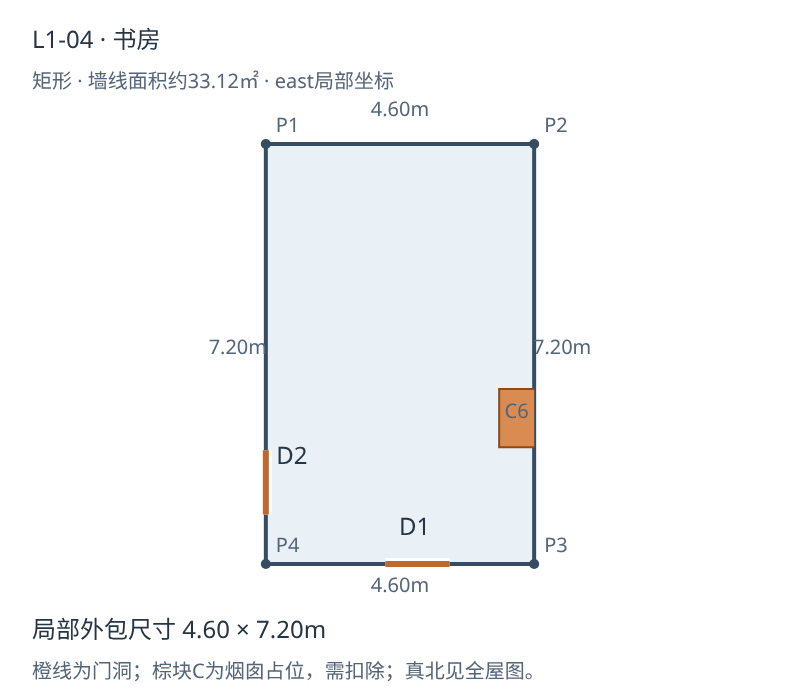

- 楼层：1层：主体一层＝东翼二层；局部框架：`east`；形状：矩形。
- 墙线面积约 33.12㎡；边长依次为 P1-P2=4.600m / P2-P3=7.200m / P3-P4=4.600m / P4-P1=7.200m。
- 局部顶点（米，按P顺序闭合）：P1=(0.0000, 0.0000)；P2=(4.6000, 0.0000)；P3=(4.6000, 7.2000)；P4=(-0.0000, 7.2000)。
- 全局顶点X/Z（米）：P1=(7.5000, -3.7000)；P2=(11.9433, -4.8906)；P3=(13.8068, 2.0641)；P4=(9.3635, 3.2547)。
- 西侧通更衣连接间；南门接东翼走廊；东邻会客室。
- 北侧临湖窗；南门通东翼走廊；西门通更衣连接间，不能误标为客厅门。
- 西墙书架、梯子取画册和厚地毯事故区仍需保留；门口位置须与本版轮廓协调。
- 东邻会客室，无白模直通门；不因相邻自行加门。

| 门洞 | 所在边 | 全局中心X/Z m | 当前宽m | 当前通向 |
|---|---|---|---|---|
| D1 | P3-P4 | 11.875, 2.582 | 1.100 | L1-06 东翼走廊 |
| D2 | P4-P1 | 9.001, 1.902 | 1.100 | L1-03 更衣连接间 |

### L1-05 会客室

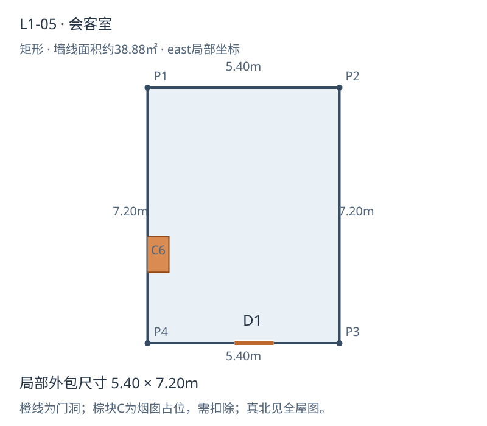

- 楼层：1层：主体一层＝东翼二层；局部框架：`east`；形状：矩形。
- 墙线面积约 38.88㎡；边长依次为 P1-P2=5.400m / P2-P3=7.200m / P3-P4=5.400m / P4-P1=7.200m。
- 局部顶点（米，按P顺序闭合）：P1=(4.6000, 0.0000)；P2=(10.0000, -0.0000)；P3=(10.0000, 7.2000)；P4=(4.6000, 7.2000)。
- 全局顶点X/Z（米）：P1=(11.9433, -4.8906)；P2=(17.1593, -6.2882)；P3=(19.0228, 0.6665)；P4=(13.8068, 2.0641)。
- 南侧经访客门斗独立抵达；书房在西侧。

| 门洞 | 所在边 | 全局中心X/Z m | 当前宽m | 当前通向 |
|---|---|---|---|---|
| D1 | P3-P4 | 16.704, 1.288 | 1.100 | L1-06 东翼走廊 |

### L1-06 东翼走廊

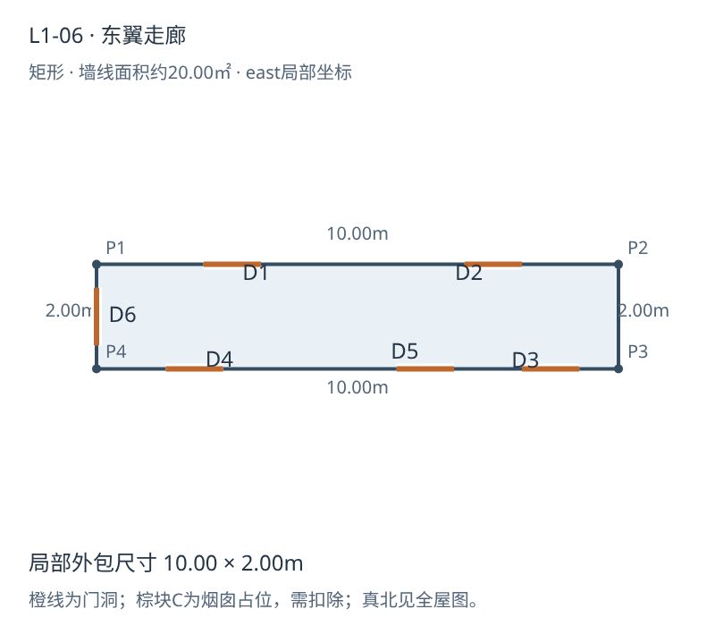

- 楼层：1层：主体一层＝东翼二层；局部框架：`east`；形状：矩形。
- 墙线面积约 20.00㎡；边长依次为 P1-P2=10.000m / P2-P3=2.000m / P3-P4=10.000m / P4-P1=2.000m。
- 局部顶点（米，按P顺序闭合）：P1=(-0.0000, 7.2000)；P2=(10.0000, 7.2000)；P3=(10.0000, 9.2000)；P4=(0.0000, 9.2000)。
- 全局顶点X/Z（米）：P1=(9.3635, 3.2547)；P2=(19.0228, 0.6665)；P3=(19.5404, 2.5983)；P4=(9.8811, 5.1865)。
- 与主体私人走廊同层相接；访客可以从东端进入。

| 门洞 | 所在边 | 全局中心X/Z m | 当前宽m | 当前通向 |
|---|---|---|---|---|
| D1 | P1-P2 | 11.875, 2.582 | 1.100 | L1-04 书房 |
| D2 | P1-P2 | 16.704, 1.288 | 1.100 | L1-05 会客室 |
| D3 | P3-P4 | 18.285, 2.935 | 1.100 | L1-12 茶水／备餐间 |
| D4 | P3-P4 | 11.692, 4.701 | 1.100 | L1-11 B 主人餐厅梯 |
| D5 | P3-P4 | 15.966, 3.556 | 1.100 | L1-13 访客门斗 |
| D6 | P4-P1 | 9.622, 4.221 | 1.100 | L1-07 转接过厅 |

### L1-07 转接过厅

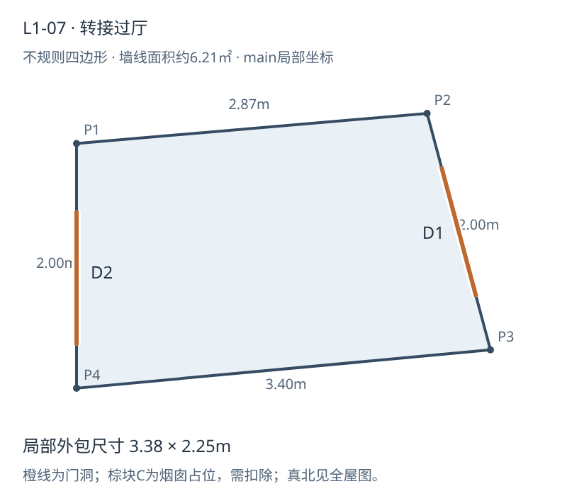

- 楼层：1层：主体一层＝东翼二层；局部框架：`main`；形状：不规则四边形。
- 墙线面积约 6.21㎡；边长依次为 P1-P2=2.874m / P2-P3=2.000m / P3-P4=3.396m / P4-P1=2.000m。
- 局部顶点（米，按P顺序闭合）：P1=(6.5000, 3.5000)；P2=(9.3635, 3.2547)；P3=(9.8811, 5.1865)；P4=(6.5000, 5.5000)。
- 全局顶点X/Z（米）：P1=(6.5000, 3.5000)；P2=(9.3635, 3.2547)；P3=(9.8811, 5.1865)；P4=(6.5000, 5.5000)。
- 消化两组建筑的十五度转角。

| 门洞 | 所在边 | 全局中心X/Z m | 当前宽m | 当前通向 |
|---|---|---|---|---|
| D1 | P2-P3 | 9.622, 4.221 | 1.100 | L1-06 东翼走廊 |
| D2 | P4-P1 | 6.500, 4.600 | 1.100 | L1-09 私人走廊 |

### L1-08 卧室小过厅

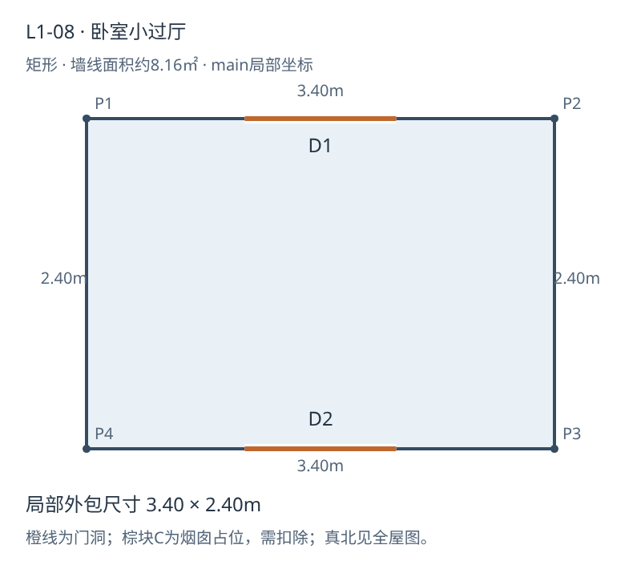

- 楼层：1层：主体一层＝东翼二层；局部框架：`main`；形状：矩形。
- 墙线面积约 8.16㎡；边长依次为 P1-P2=3.400m / P2-P3=2.400m / P3-P4=3.400m / P4-P1=2.400m。
- 局部顶点（米，按P顺序闭合）：P1=(3.1000, 1.3000)；P2=(6.5000, 1.3000)；P3=(6.5000, 3.7000)；P4=(3.1000, 3.7000)。
- 全局顶点X/Z（米）：P1=(3.1000, 1.3000)；P2=(6.5000, 1.3000)；P3=(6.5000, 3.7000)；P4=(3.1000, 3.7000)。
- 卧室门前的缓冲空间。

| 门洞 | 所在边 | 全局中心X/Z m | 当前宽m | 当前通向 |
|---|---|---|---|---|
| D1 | P1-P2 | 4.800, 1.300 | 1.100 | L1-02 罗辑卧室 |
| D2 | P3-P4 | 4.800, 3.700 | 1.100 | L1-09 私人走廊 |

### L1-09 私人走廊

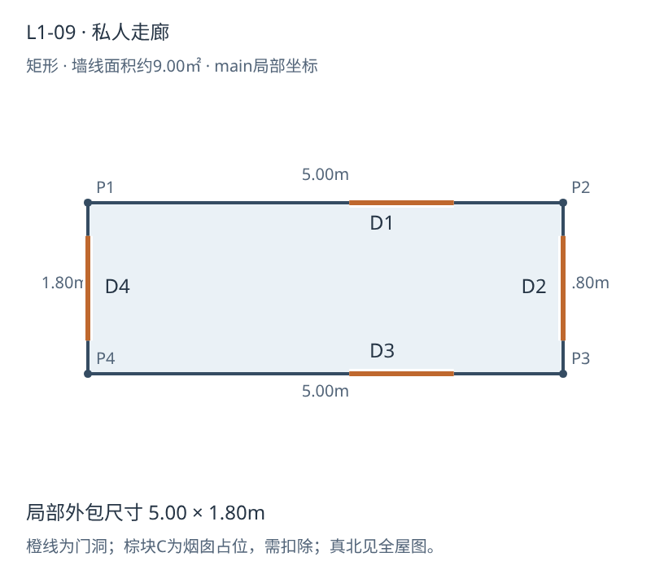

- 楼层：1层：主体一层＝东翼二层；局部框架：`main`；形状：矩形。
- 墙线面积约 9.00㎡；边长依次为 P1-P2=5.000m / P2-P3=1.800m / P3-P4=5.000m / P4-P1=1.800m。
- 局部顶点（米，按P顺序闭合）：P1=(1.5000, 3.7000)；P2=(6.5000, 3.7000)；P3=(6.5000, 5.5000)；P4=(1.5000, 5.5000)。
- 全局顶点X/Z（米）：P1=(1.5000, 3.7000)；P2=(6.5000, 3.7000)；P3=(6.5000, 5.5000)；P4=(1.5000, 5.5000)。
- 入口可关门，与主门厅分隔。

| 门洞 | 所在边 | 全局中心X/Z m | 当前宽m | 当前通向 |
|---|---|---|---|---|
| D1 | P1-P2 | 4.800, 3.700 | 1.100 | L1-08 卧室小过厅 |
| D2 | P2-P3 | 6.500, 4.600 | 1.100 | L1-07 转接过厅 |
| D3 | P3-P4 | 4.800, 5.500 | 1.100 | L1-10 私人浴室 |
| D4 | P4-P1 | 1.500, 4.600 | 1.100 | L1-15 主门厅 · A楼梯 |

### L1-10 私人浴室

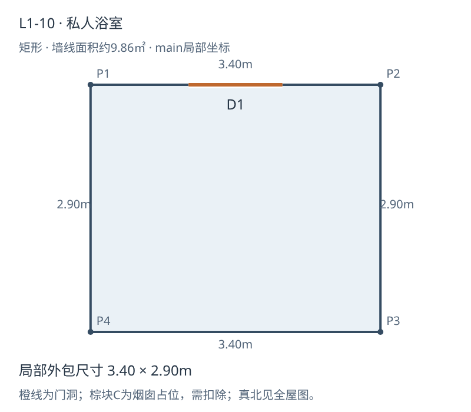

- 楼层：1层：主体一层＝东翼二层；局部框架：`main`；形状：矩形。
- 墙线面积约 9.86㎡；边长依次为 P1-P2=3.400m / P2-P3=2.900m / P3-P4=3.400m / P4-P1=2.900m。
- 局部顶点（米，按P顺序闭合）：P1=(3.1000, 5.5000)；P2=(6.5000, 5.5000)；P3=(6.5000, 8.4000)；P4=(3.1000, 8.4000)。
- 全局顶点X/Z（米）：P1=(3.1000, 5.5000)；P2=(6.5000, 5.5000)；P3=(6.5000, 8.4000)；P4=(3.1000, 8.4000)。
- 由私人走廊进入，不必穿过书房；仅洗浴，不含厕所。

| 门洞 | 所在边 | 全局中心X/Z m | 当前宽m | 当前通向 |
|---|---|---|---|---|
| D1 | P1-P2 | 4.800, 5.500 | 1.100 | L1-09 私人走廊 |

### L1-11 B 主人餐厅梯

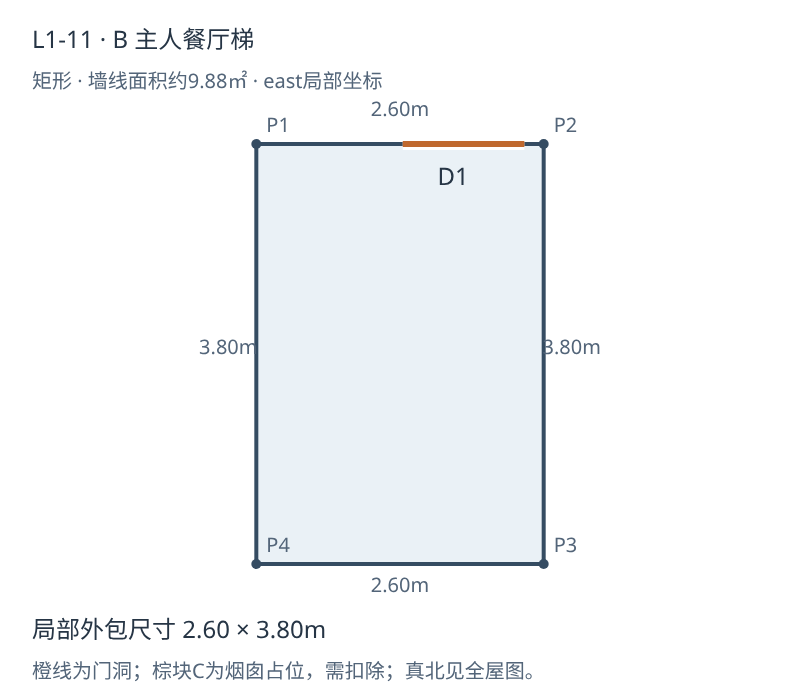

- 楼层：1层：主体一层＝东翼二层；局部框架：`east`；形状：矩形。
- 墙线面积约 9.88㎡；边长依次为 P1-P2=2.600m / P2-P3=3.800m / P3-P4=2.600m / P4-P1=3.800m。
- 局部顶点（米，按P顺序闭合）：P1=(0.0000, 9.2000)；P2=(2.6000, 9.2000)；P3=(2.6000, 13.0000)；P4=(0.0000, 13.0000)。
- 全局顶点X/Z（米）：P1=(9.8811, 5.1865)；P2=(12.3925, 4.5136)；P3=(13.3761, 8.1841)；P4=(10.8646, 8.8570)。
- 折返双跑楼梯；上层东北侧开放口中心u1.875接东翼走廊，不设向踏步开启的门扇。20级×0.16m跨3.20m，两跑各10级，9踏面×0.27m；北端楼层平台借用既有走廊，南侧中间平台深1.07m。净高/结构待剖面复核。

| 门洞 | 所在边 | 全局中心X/Z m | 当前宽m | 当前通向 |
|---|---|---|---|---|
| D1 | P1-P2 | 11.692, 4.701 | 1.100 | L1-06 东翼走廊 |

### L1-12 茶水／备餐间

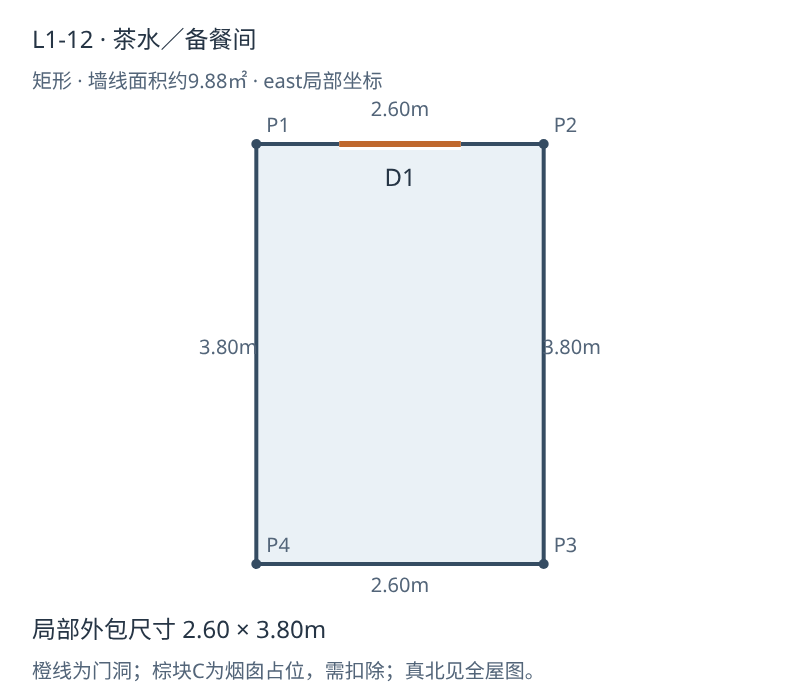

- 楼层：1层：主体一层＝东翼二层；局部框架：`east`；形状：矩形。
- 墙线面积约 9.88㎡；边长依次为 P1-P2=2.600m / P2-P3=3.800m / P3-P4=2.600m / P4-P1=3.800m。
- 局部顶点（米，按P顺序闭合）：P1=(7.4000, 9.2000)；P2=(10.0000, 9.2000)；P3=(10.0000, 13.0000)；P4=(7.4000, 13.0000)。
- 全局顶点X/Z（米）：P1=(17.0290, 3.2713)；P2=(19.5404, 2.5983)；P3=(20.5239, 6.2688)；P4=(18.0125, 6.9418)。
- 原楼梯位置改为会客配套的茶水备餐空间。

| 门洞 | 所在边 | 全局中心X/Z m | 当前宽m | 当前通向 |
|---|---|---|---|---|
| D1 | P1-P2 | 18.285, 2.935 | 1.100 | L1-06 东翼走廊 |

### L1-13 访客门斗

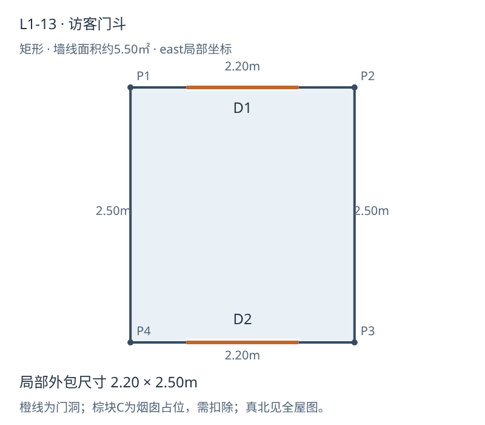

- 楼层：1层：主体一层＝东翼二层；局部框架：`east`；形状：矩形。
- 墙线面积约 5.50㎡；边长依次为 P1-P2=2.200m / P2-P3=2.500m / P3-P4=2.200m / P4-P1=2.500m。
- 局部顶点（米，按P顺序闭合）：P1=(5.2000, 9.2000)；P2=(7.4000, 9.2000)；P3=(7.4000, 11.7000)；P4=(5.2000, 11.7000)。
- 全局顶点X/Z（米）：P1=(14.9039, 3.8407)；P2=(17.0290, 3.2713)；P3=(17.6760, 5.6861)；P4=(15.5510, 6.2555)。
- 陆侧独立入口，经东翼走廊到会客室。

| 门洞 | 所在边 | 全局中心X/Z m | 当前宽m | 当前通向 |
|---|---|---|---|---|
| D1 | P1-P2 | 15.966, 3.556 | 1.100 | L1-06 东翼走廊 |
| D2 | P3-P4 | 16.613, 5.971 | 1.100 | OUTSIDE_OR_UNMODELED 室外或未建模空间 |

### L1-14 南侧短过厅

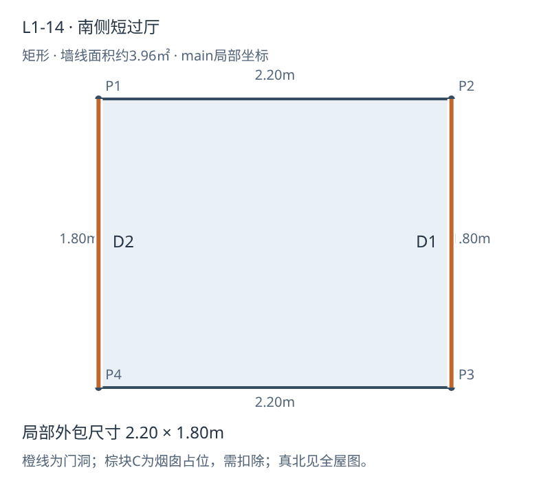

- 楼层：1层：主体一层＝东翼二层；局部框架：`main`；形状：矩形。
- 墙线面积约 3.96㎡；边长依次为 P1-P2=2.200m / P2-P3=1.800m / P3-P4=2.200m / P4-P1=1.800m。
- 局部顶点（米，按P顺序闭合）：P1=(-5.3000, 3.7000)；P2=(-3.1000, 3.7000)；P3=(-3.1000, 5.5000)；P4=(-5.3000, 5.5000)。
- 全局顶点X/Z（米）：P1=(-5.3000, 3.7000)；P2=(-3.1000, 3.7000)；P3=(-3.1000, 5.5000)；P4=(-5.3000, 5.5000)。
- 仅在客厅南侧连接主门厅与后加西翼；不再沿客厅西墙占一整条。

| 门洞 | 所在边 | 全局中心X/Z m | 当前宽m | 当前通向 |
|---|---|---|---|---|
| D1 | P2-P3 | -3.100, 4.600 | 1.800 | L1-15 主门厅 · A楼梯 |
| D2 | P4-P1 | -5.300, 4.600 | 1.800 | L1-27 西翼唯一贯通走廊 |

### L1-15 主门厅 · A楼梯

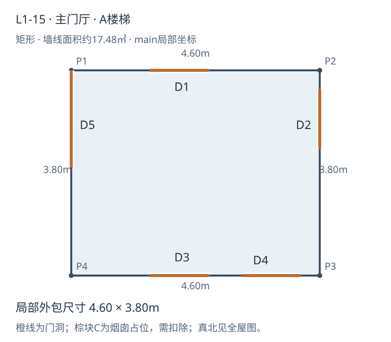

- 楼层：1层：主体一层＝东翼二层；局部框架：`main`；形状：矩形。
- 墙线面积约 17.48㎡；边长依次为 P1-P2=4.600m / P2-P3=3.800m / P3-P4=4.600m / P4-P1=3.800m。
- 局部顶点（米，按P顺序闭合）：P1=(-3.1000, 3.7000)；P2=(1.5000, 3.7000)；P3=(1.5000, 7.5000)；P4=(-3.1000, 7.5000)。
- 全局顶点X/Z（米）：P1=(-3.1000, 3.7000)；P2=(1.5000, 3.7000)；P3=(1.5000, 7.5000)；P4=(-3.1000, 7.5000)。
- 门斗向北直通本厅，再从北门直接进入客厅；A楼梯位于侧边。

| 门洞 | 所在边 | 全局中心X/Z m | 当前宽m | 当前通向 |
|---|---|---|---|---|
| D1 | P1-P2 | -1.100, 3.700 | 1.100 | L1-01 主客厅 |
| D2 | P2-P3 | 1.500, 4.600 | 1.100 | L1-09 私人走廊 |
| D3 | P3-P4 | -1.100, 7.500 | 1.100 | L1-16 主入口门斗 |
| D4 | P3-P4 | 0.600, 7.500 | 1.100 | L1-17 门厅附属间 · 用途待定 |
| D5 | P4-P1 | -3.100, 4.600 | 1.800 | L1-14 南侧短过厅 |

### L1-16 主入口门斗

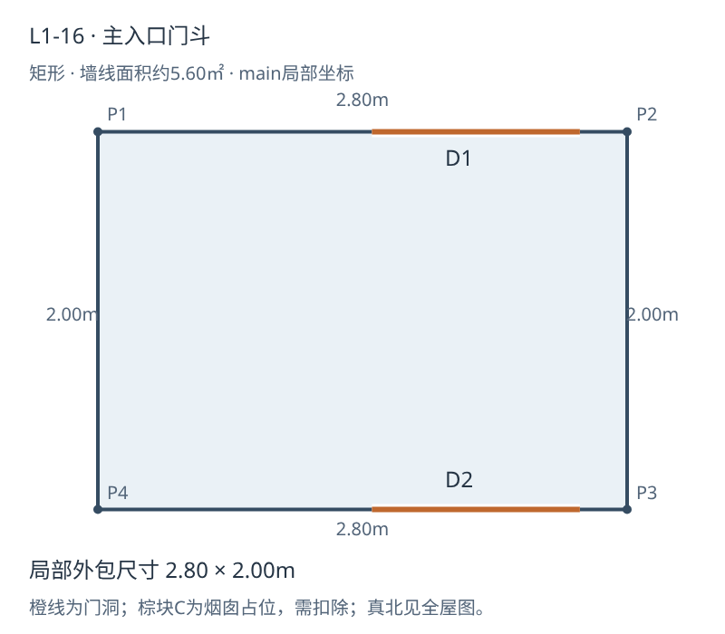

- 楼层：1层：主体一层＝东翼二层；局部框架：`main`；形状：矩形。
- 墙线面积约 5.60㎡；边长依次为 P1-P2=2.800m / P2-P3=2.000m / P3-P4=2.800m / P4-P1=2.000m。
- 局部顶点（米，按P顺序闭合）：P1=(-3.1000, 7.5000)；P2=(-0.3000, 7.5000)；P3=(-0.3000, 9.5000)；P4=(-3.1000, 9.5000)。
- 全局顶点X/Z（米）：P1=(-3.1000, 7.5000)；P2=(-0.3000, 7.5000)；P3=(-0.3000, 9.5000)；P4=(-3.1000, 9.5000)。
- 换鞋、挂雨衣；朝陆侧庭院。

| 门洞 | 所在边 | 全局中心X/Z m | 当前宽m | 当前通向 |
|---|---|---|---|---|
| D1 | P1-P2 | -1.100, 7.500 | 1.100 | L1-15 主门厅 · A楼梯 |
| D2 | P3-P4 | -1.100, 9.500 | 1.100 | OUTSIDE_OR_UNMODELED 室外或未建模空间 |

### L1-17 门厅附属间 · 用途待定

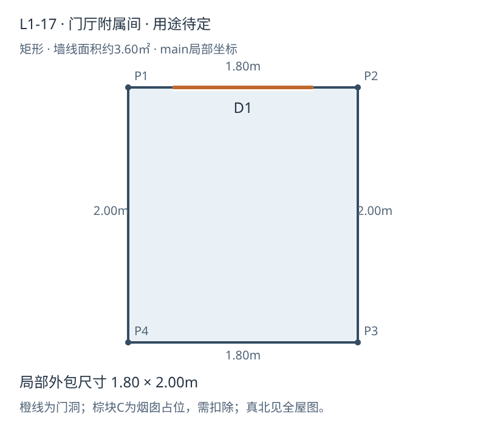

- 楼层：1层：主体一层＝东翼二层；局部框架：`main`；形状：矩形。
- 墙线面积约 3.60㎡；边长依次为 P1-P2=1.800m / P2-P3=2.000m / P3-P4=1.800m / P4-P1=2.000m。
- 局部顶点（米，按P顺序闭合）：P1=(-0.3000, 7.5000)；P2=(1.5000, 7.5000)；P3=(1.5000, 9.5000)；P4=(-0.3000, 9.5000)。
- 全局顶点X/Z（米）：P1=(-0.3000, 7.5000)；P2=(1.5000, 7.5000)；P3=(1.5000, 9.5000)；P4=(-0.3000, 9.5000)。
- 取消原客用WC功能，不设马桶；原轮廓暂留待定用途，仍由主门厅进入。主楼如厕去西翼。

| 门洞 | 所在边 | 全局中心X/Z m | 当前宽m | 当前通向 |
|---|---|---|---|---|
| D1 | P1-P2 | 0.600, 7.500 | 1.100 | L1-15 主门厅 · A楼梯 |

### L1-18 梯形画室 · 原家庭起居室

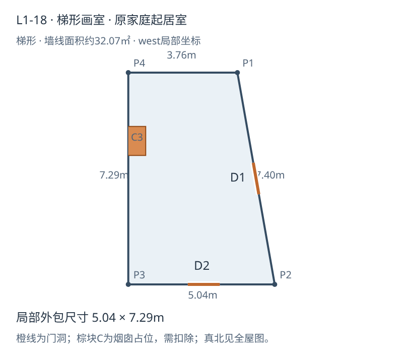

- 楼层：1层：主体一层＝东翼二层；局部框架：`west`；形状：梯形。
- 墙线面积约 32.07㎡；边长依次为 P1-P2=7.400m / P2-P3=5.044m / P3-P4=7.288m / P4-P1=3.759m。
- 局部顶点（米，按P顺序闭合）：P1=(-1.4413, -8.1739)；P2=(-0.1563, -0.8863)；P3=(-5.2000, -0.8863)；P4=(-5.2000, -8.1739)。
- 全局顶点X/Z（米）：P1=(-5.3000, -3.7000)；P2=(-5.3000, 3.7000)；P3=(-10.2671, 2.8242)；P4=(-9.0016, -4.3527)。
- 原家庭起居室改作庄颜画室，保留梯形收口、东侧主客厅门与南侧贯通走廊门，西侧老人房不开直通门。42-L上楼后经主门厅/南侧短过厅到本室，再沿走廊回卧室；内部洗笔/画架/会谈座位待单间细排。C3与原炉位保留，不改变核心。
- 这是西翼贴回主楼的梯形收口；其余西翼房间采用整体内折约10°的矩形网格。
- 老人房共墙不开门，老人房仅从贯通走廊进入。

| 门洞 | 所在边 | 全局中心X/Z m | 当前宽m | 当前通向 |
|---|---|---|---|---|
| D1 | P1-P2 | -5.300, 0.000 | 1.100 | L1-01 主客厅 |
| D2 | P2-P3 | -7.707, 3.276 | 1.100 | L1-27 西翼唯一贯通走廊 |

### L1-19 老人房 · 主人区

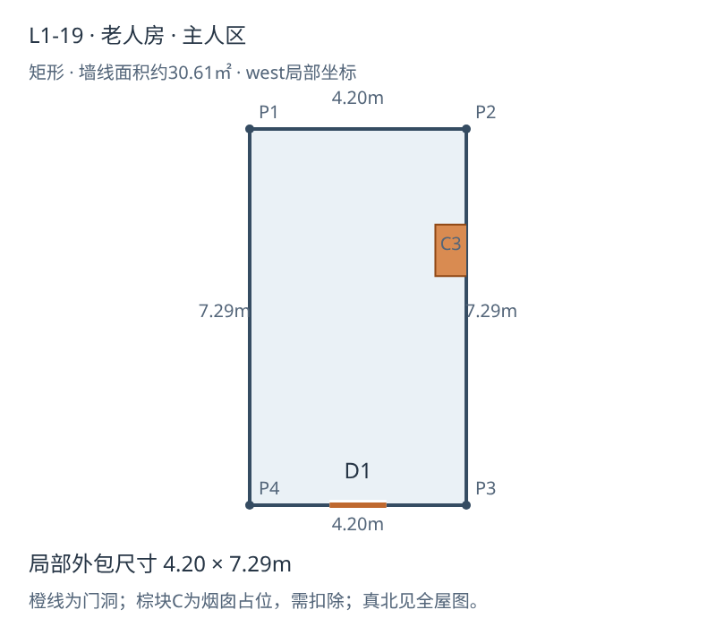

- 楼层：1层：主体一层＝东翼二层；局部框架：`west`；形状：矩形。
- 墙线面积约 30.61㎡；边长依次为 P1-P2=4.200m / P2-P3=7.288m / P3-P4=4.200m / P4-P1=7.288m。
- 局部顶点（米，按P顺序闭合）：P1=(-9.4000, -8.1739)；P2=(-5.2000, -8.1739)；P3=(-5.2000, -0.8863)；P4=(-9.4000, -0.8863)。
- 全局顶点X/Z（米）：P1=(-13.1378, -5.0820)；P2=(-9.0016, -4.3527)；P3=(-10.2671, 2.8242)；P4=(-14.4033, 2.0948)。
- 只从南侧贯通走廊进入；与画室（原家庭起居室）之间为实墙，不设直通门。对面保留私用浴室。
- 属于主人自用房间，正对走廊另一侧的老人房私用浴室。
- 只从贯通走廊进入，不直通家庭起居室或其他公共起居空间。

| 门洞 | 所在边 | 全局中心X/Z m | 当前宽m | 当前通向 |
|---|---|---|---|---|
| D1 | P3-P4 | -12.335, 2.459 | 1.100 | L1-27 西翼唯一贯通走廊 |

### L1-20 老人房私用浴室

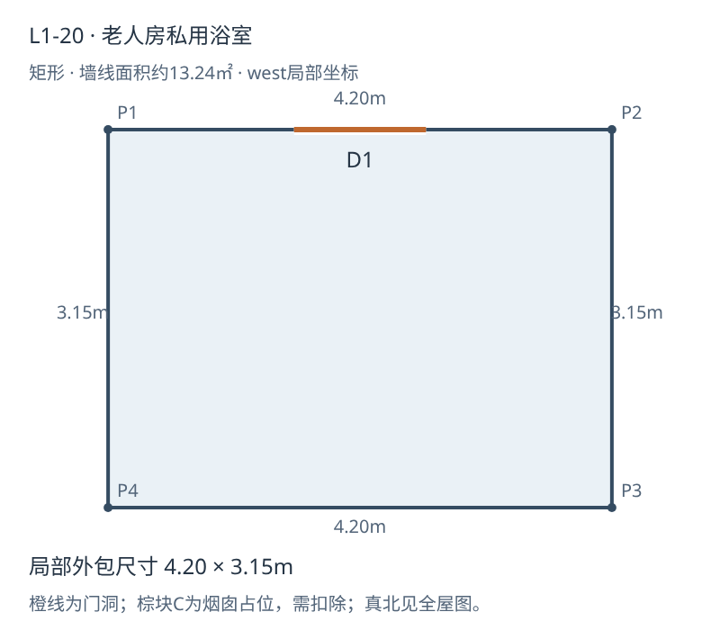

- 楼层：1层：主体一层＝东翼二层；局部框架：`west`；形状：矩形。
- 墙线面积约 13.24㎡；边长依次为 P1-P2=4.200m / P2-P3=3.151m / P3-P4=4.200m / P4-P1=3.151m。
- 局部顶点（米，按P顺序闭合）：P1=(-9.4000, 0.8863)；P2=(-5.2000, 0.8863)；P3=(-5.2000, 4.0377)；P4=(-9.4000, 4.0377)。
- 全局顶点X/Z（米）：P1=(-14.7111, 3.8406)；P2=(-10.5749, 4.5699)；P3=(-11.1221, 7.6734)；P4=(-15.2583, 6.9441)。
- 仍在老人房正对面，隔贯通走廊相望；门从走廊开入。

| 门洞 | 所在边 | 全局中心X/Z m | 当前宽m | 当前通向 |
|---|---|---|---|---|
| D1 | P1-P2 | -12.643, 4.205 | 1.100 | L1-27 西翼唯一贯通走廊 |

### L1-21 主人衣帽／储物

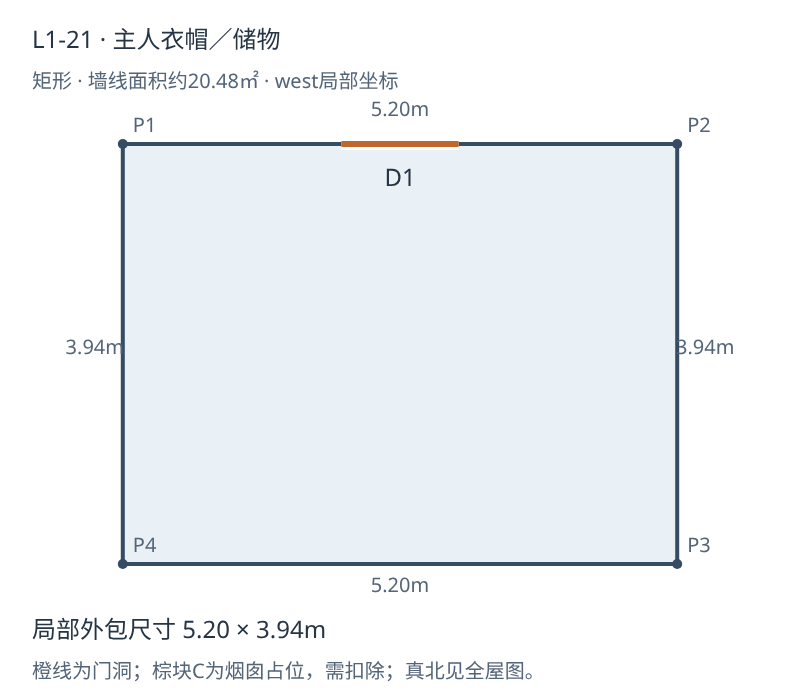

- 楼层：1层：主体一层＝东翼二层；局部框架：`west`；形状：矩形。
- 墙线面积约 20.48㎡；边长依次为 P1-P2=5.200m / P2-P3=3.939m / P3-P4=5.200m / P4-P1=3.939m。
- 局部顶点（米，按P顺序闭合）：P1=(-5.2000, 0.8863)；P2=(0.0000, 0.8863)；P3=(-0.0000, 4.8256)；P4=(-5.2000, 4.8256)。
- 全局顶点X/Z（米）：P1=(-10.5749, 4.5699)；P2=(-5.4539, 5.4729)；P3=(-6.1379, 9.3522)；P4=(-11.2589, 8.4493)。
- 主人房间的附属空间；车库接在更西边的旧佣人入口前。

| 门洞 | 所在边 | 全局中心X/Z m | 当前宽m | 当前通向 |
|---|---|---|---|---|
| D1 | P1-P2 | -8.014, 5.021 | 1.100 | L1-27 西翼唯一贯通走廊 |

### L1-22 浴室布草柜间

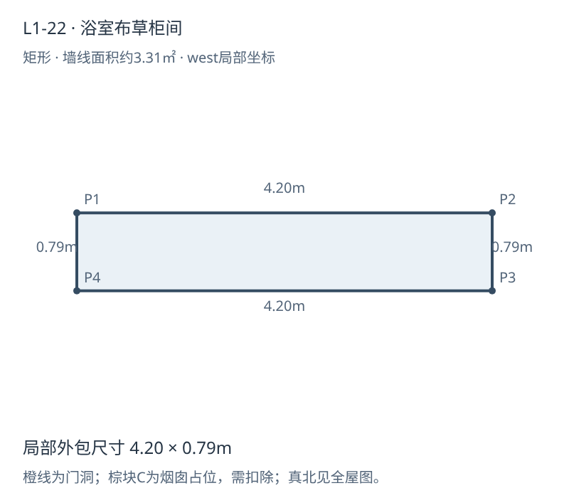

- 楼层：1层：主体一层＝东翼二层；局部框架：`west`；形状：矩形。
- 墙线面积约 3.31㎡；边长依次为 P1-P2=4.200m / P2-P3=0.788m / P3-P4=4.200m / P4-P1=0.788m。
- 局部顶点（米，按P顺序闭合）：P1=(-9.4000, 4.0377)；P2=(-5.2000, 4.0377)；P3=(-5.2000, 4.8256)；P4=(-9.4000, 4.8256)。
- 全局顶点X/Z（米）：P1=(-15.2583, 6.9441)；P2=(-11.1221, 7.6734)；P3=(-11.2589, 8.4493)；P4=(-15.3951, 7.7200)。
- 浴室南侧的附属布草柜带，不形成第二条走廊。
- 这是狭长柜带，不按可进入的独立卧室/走廊理解；柜门细分尚未画。

当前无门洞数据；柜带或户外区不据此推定为可进入的独立房间。

### L1-23 坎特房

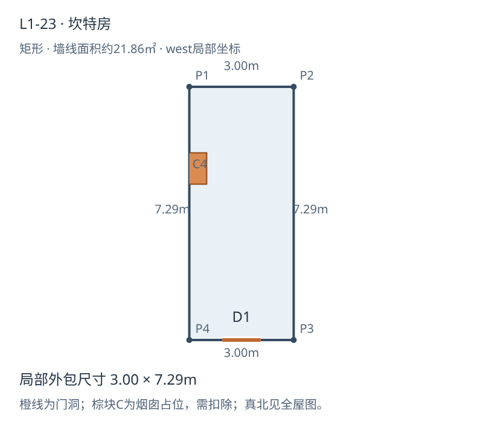

- 楼层：1层：主体一层＝东翼二层；局部框架：`west`；形状：矩形。
- 墙线面积约 21.86㎡；边长依次为 P1-P2=3.000m / P2-P3=7.288m / P3-P4=3.000m / P4-P1=7.288m。
- 局部顶点（米，按P顺序闭合）：P1=(-12.4000, -8.1739)；P2=(-9.4000, -8.1739)；P3=(-9.4000, -0.8863)；P4=(-12.4000, -0.8863)。
- 全局顶点X/Z（米）：P1=(-16.0922, -5.6030)；P2=(-13.1378, -5.0820)；P3=(-14.4033, 2.0948)；P4=(-17.3577, 1.5739)。
- 佣人自用卧室，直接从同一条贯通走廊进入。

| 门洞 | 所在边 | 全局中心X/Z m | 当前宽m | 当前通向 |
|---|---|---|---|---|
| D1 | P3-P4 | -15.880, 1.834 | 1.100 | L1-27 西翼唯一贯通走廊 |

### L1-24 女仆房 · 1层

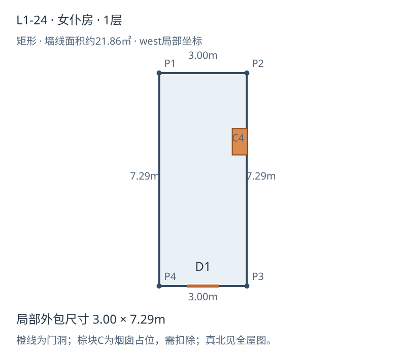

- 楼层：1层：主体一层＝东翼二层；局部框架：`west`；形状：矩形。
- 墙线面积约 21.86㎡；边长依次为 P1-P2=3.000m / P2-P3=7.288m / P3-P4=3.000m / P4-P1=7.288m。
- 局部顶点（米，按P顺序闭合）：P1=(-15.4000, -8.1739)；P2=(-12.4000, -8.1739)；P3=(-12.4000, -0.8863)；P4=(-15.4000, -0.8863)。
- 全局顶点X/Z（米）：P1=(-19.0467, -6.1239)；P2=(-16.0922, -5.6030)；P3=(-17.3577, 1.5739)；P4=(-20.3121, 1.0530)。
- 佣人自用的一层卧室，门开向贯通走廊；另一间仍在−1层。

| 门洞 | 所在边 | 全局中心X/Z m | 当前宽m | 当前通向 |
|---|---|---|---|---|
| D1 | P3-P4 | -18.835, 1.313 | 1.100 | L1-27 西翼唯一贯通走廊 |

### L1-25 工作衣帽／布草

- 楼层：1层：主体一层＝东翼二层；局部框架：`west`；形状：矩形。
- 墙线面积约 11.28㎡；边长依次为 P1-P2=3.000m / P2-P3=3.761m / P3-P4=3.000m / P4-P1=3.761m。
- 局部顶点（米，按P顺序闭合）：P1=(-18.4000, -8.1739)；P2=(-15.4000, -8.1739)；P3=(-15.4000, -4.4126)；P4=(-18.4000, -4.4126)。
- 全局顶点X/Z（米）：P1=(-22.0011, -6.6449)；P2=(-19.0467, -6.1239)；P3=(-19.6998, -2.4197)；P4=(-22.6542, -2.9407)。
- 佣人区的工作衣帽与布草空间。

| 门洞 | 所在边 | 全局中心X/Z m | 当前宽m | 当前通向 |
|---|---|---|---|---|
| D1 | P3-P4 | -21.177, -2.680 | 1.100 | L1-26 C 西侧服务梯 |

### L1-26 C 西侧服务梯

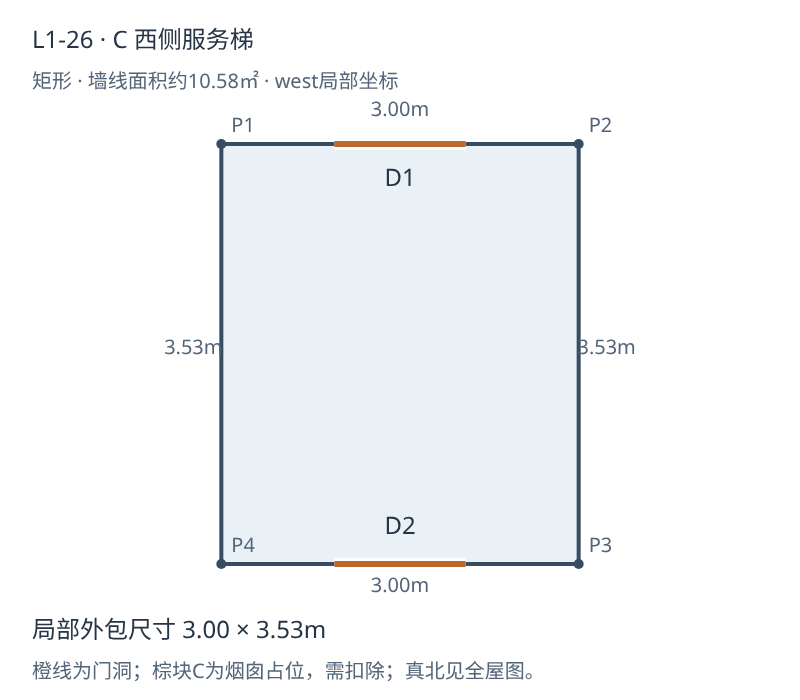

- 楼层：1层：主体一层＝东翼二层；局部框架：`west`；形状：矩形。
- 墙线面积约 10.58㎡；边长依次为 P1-P2=3.000m / P2-P3=3.526m / P3-P4=3.000m / P4-P1=3.526m。
- 局部顶点（米，按P顺序闭合）：P1=(-18.4000, -4.4126)；P2=(-15.4000, -4.4126)；P3=(-15.4000, -0.8863)；P4=(-18.4000, -0.8863)。
- 全局顶点X/Z（米）：P1=(-22.6542, -2.9407)；P2=(-19.6998, -2.4197)；P3=(-20.3121, 1.0530)；P4=(-23.2666, 0.5320)。
- 佣人自己的上下楼联系，位置偏西，不是给主人设计的观影梯。

| 门洞 | 所在边 | 全局中心X/Z m | 当前宽m | 当前通向 |
|---|---|---|---|---|
| D1 | P1-P2 | -21.177, -2.680 | 1.100 | L1-25 工作衣帽／布草 |
| D2 | P3-P4 | -21.789, 0.792 | 1.100 | L1-27 西翼唯一贯通走廊 |

### L1-27 西翼唯一贯通走廊

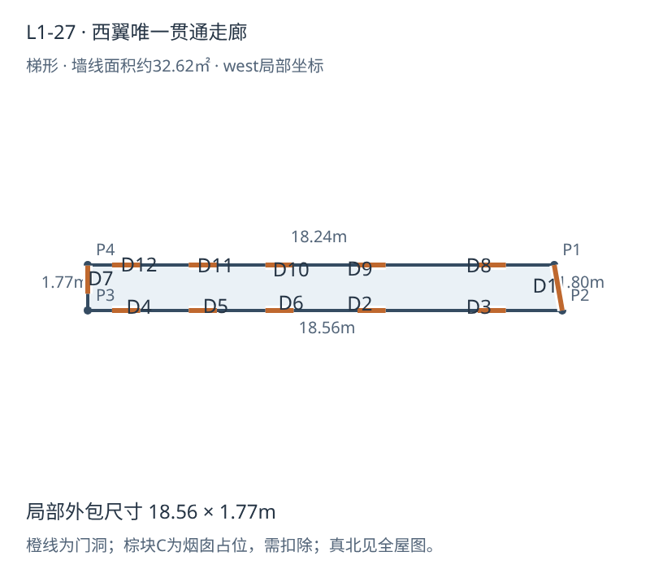

- 楼层：1层：主体一层＝东翼二层；局部框架：`west`；形状：梯形。
- 墙线面积约 32.62㎡；边长依次为 P1-P2=1.800m / P2-P3=18.556m / P3-P4=1.773m / P4-P1=18.244m。
- 局部顶点（米，按P顺序闭合）：P1=(-0.1563, -0.8863)；P2=(0.1563, 0.8863)；P3=(-18.4000, 0.8863)；P4=(-18.4000, -0.8863)。
- 全局顶点X/Z（米）：P1=(-5.3000, 3.7000)；P2=(-5.3000, 5.5000)；P3=(-23.5744, 2.2777)；P4=(-23.2666, 0.5320)。
- 沿西翼自己的角度贯通；东端斜切贴合主楼短过厅，其他房间维持规整矩形。
- 西翼只有这一条贯通走廊，东接主楼南侧短过厅；无主佣门禁或封闭分界。
- 主佣之分表示自用生活范围，佣人可继续到主人空间服务。
- 后代取车、观影沿它反向进入佣人生活区；不要另建一条主人专用通道或棚架。

| 门洞 | 所在边 | 全局中心X/Z m | 当前宽m | 当前通向 |
|---|---|---|---|---|
| D1 | P1-P2 | -5.300, 4.600 | 1.800 | L1-14 南侧短过厅 |
| D2 | P2-P3 | -12.643, 4.205 | 1.100 | L1-20 老人房私用浴室 |
| D3 | P2-P3 | -8.014, 5.021 | 1.100 | L1-21 主人衣帽／储物 |
| D4 | P2-P3 | -22.097, 2.538 | 1.100 | L1-28 洗衣／家务间 |
| D5 | P2-P3 | -19.143, 3.059 | 1.100 | L1-29 佣人旧入口／备勤 |
| D6 | P2-P3 | -16.188, 3.580 | 1.100 | L1-30 佣人浴室／WC |
| D7 | P3-P4 | -23.366, 1.093 | 1.100 | X-04 放映厅：观影门斗 |
| D8 | P4-P1 | -7.707, 3.276 | 1.100 | L1-18 梯形画室 · 原家庭起居室 |
| D9 | P4-P1 | -12.335, 2.459 | 1.100 | L1-19 老人房 · 主人区 |
| D10 | P4-P1 | -15.880, 1.834 | 1.100 | L1-23 坎特房 |
| D11 | P4-P1 | -18.835, 1.313 | 1.100 | L1-24 女仆房 · 1层 |
| D12 | P4-P1 | -21.789, 0.792 | 1.100 | L1-26 C 西侧服务梯 |

### L1-28 洗衣／家务间

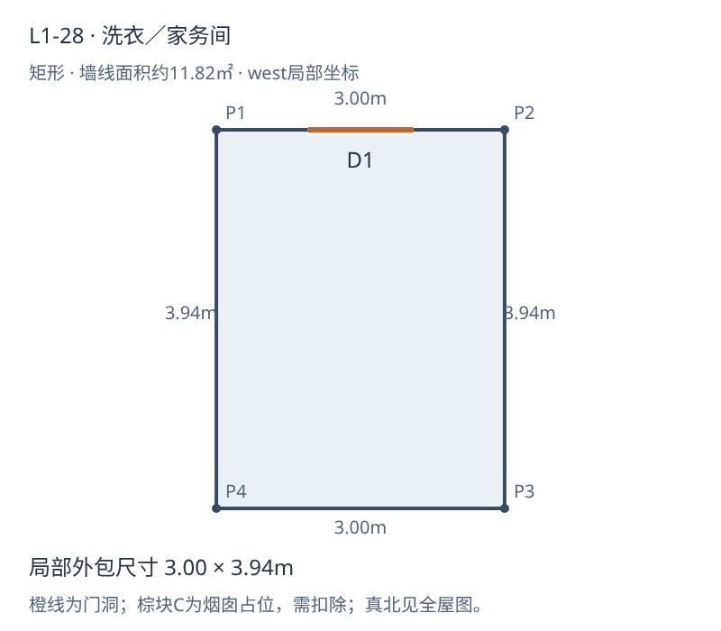

- 楼层：1层：主体一层＝东翼二层；局部框架：`west`；形状：矩形。
- 墙线面积约 11.82㎡；边长依次为 P1-P2=3.000m / P2-P3=3.939m / P3-P4=3.000m / P4-P1=3.939m。
- 局部顶点（米，按P顺序闭合）：P1=(-18.4000, 0.8863)；P2=(-15.4000, 0.8863)；P3=(-15.4000, 4.8256)；P4=(-18.4000, 4.8256)。
- 全局顶点X/Z（米）：P1=(-23.5744, 2.2777)；P2=(-20.6199, 2.7987)；P3=(-21.3040, 6.6781)；P4=(-24.2584, 6.1571)。
- 佣人自用的洗衣和家务操作空间，仍接原有家务通道。

| 门洞 | 所在边 | 全局中心X/Z m | 当前宽m | 当前通向 |
|---|---|---|---|---|
| D1 | P1-P2 | -22.097, 2.538 | 1.100 | L1-27 西翼唯一贯通走廊 |

### L1-29 佣人旧入口／备勤

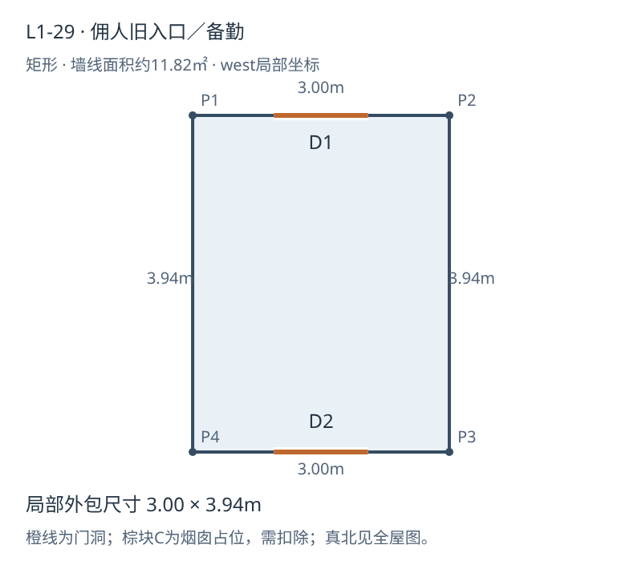

- 楼层：1层：主体一层＝东翼二层；局部框架：`west`；形状：矩形。
- 墙线面积约 11.82㎡；边长依次为 P1-P2=3.000m / P2-P3=3.939m / P3-P4=3.000m / P4-P1=3.939m。
- 局部顶点（米，按P顺序闭合）：P1=(-15.4000, 0.8863)；P2=(-12.4000, 0.8863)；P3=(-12.4000, 4.8256)；P4=(-15.4000, 4.8256)。
- 全局顶点X/Z（米）：P1=(-20.6199, 2.7987)；P2=(-17.6655, 3.3196)；P3=(-18.3496, 7.1990)；P4=(-21.3040, 6.6781)。
- 原本是直通陆侧院子的佣人出入口，兼备勤和杂务；后代把车库盖在这扇旧门前。

| 门洞 | 所在边 | 全局中心X/Z m | 当前宽m | 当前通向 |
|---|---|---|---|---|
| D1 | P1-P2 | -19.143, 3.059 | 1.100 | L1-27 西翼唯一贯通走廊 |
| D2 | P3-P4 | -19.827, 6.939 | 1.100 | L1-31 堵在旧门前的车库 |

### L1-30 佣人浴室／WC

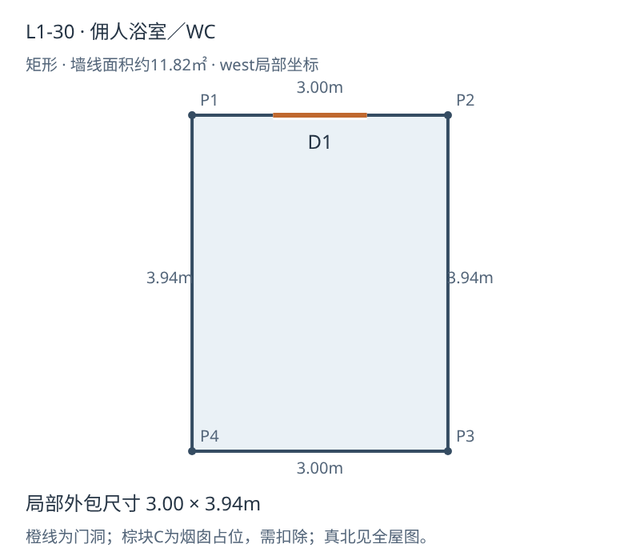

- 楼层：1层：主体一层＝东翼二层；局部框架：`west`；形状：矩形。
- 墙线面积约 11.82㎡；边长依次为 P1-P2=3.000m / P2-P3=3.939m / P3-P4=3.000m / P4-P1=3.939m。
- 局部顶点（米，按P顺序闭合）：P1=(-12.4000, 0.8863)；P2=(-9.4000, 0.8863)；P3=(-9.4000, 4.8256)；P4=(-12.4000, 4.8256)。
- 全局顶点X/Z（米）：P1=(-17.6655, 3.3196)；P2=(-14.7111, 3.8406)；P3=(-15.3951, 7.7200)；P4=(-18.3496, 7.1990)。
- 服务佣人住宿，与老人房私用浴室分开。

| 门洞 | 所在边 | 全局中心X/Z m | 当前宽m | 当前通向 |
|---|---|---|---|---|
| D1 | P1-P2 | -16.188, 3.580 | 1.100 | L1-27 西翼唯一贯通走廊 |

### L1-31 堵在旧门前的车库

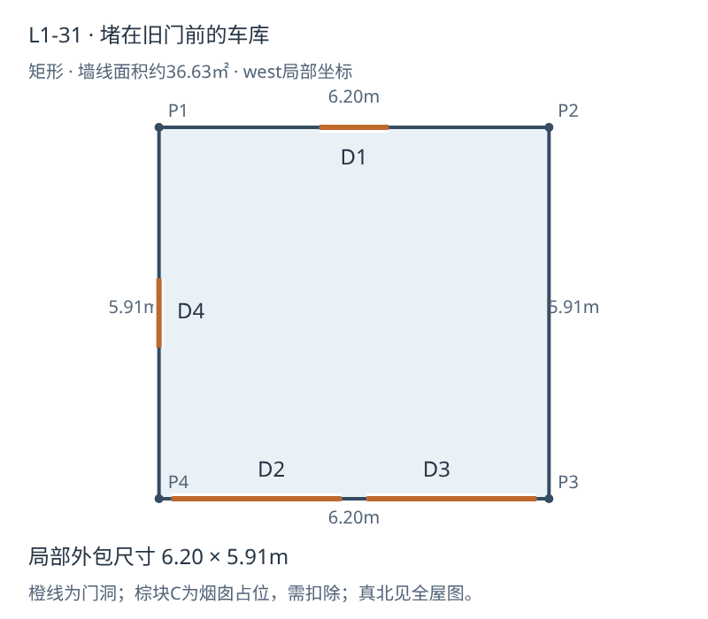

- 楼层：1层：主体一层＝东翼二层；局部框架：`west`；形状：矩形。
- 墙线面积约 36.63㎡；边长依次为 P1-P2=6.200m / P2-P3=5.909m / P3-P4=6.200m / P4-P1=5.909m。
- 局部顶点（米，按P顺序闭合）：P1=(-17.0000, 4.8256)；P2=(-10.8000, 4.8256)；P3=(-10.8000, 10.7344)；P4=(-17.0000, 10.7344)。
- 全局顶点X/Z（米）：P1=(-22.8797, 6.4002)；P2=(-16.7739, 7.4768)；P3=(-17.7999, 13.2959)；P4=(-23.9057, 12.2193)。
- 后期在佣人原入口外扩出两车位车库。后代亲自取车时，从主人房间借用佣人走廊、备勤入口进入车库。
- 车库晚于西翼，建在原佣人入口前；不得改回直通主人衣帽区。
- 两车位只用于代步，不是私人收藏车库。

| 门洞 | 所在边 | 全局中心X/Z m | 当前宽m | 当前通向 |
|---|---|---|---|---|
| D1 | P1-P2 | -19.827, 6.939 | 1.100 | L1-29 佣人旧入口／备勤 |
| D2 | P3-P4 | -22.379, 12.489 | 2.700 | OUTSIDE_OR_UNMODELED 室外或未建模空间 |
| D3 | P3-P4 | -19.326, 13.027 | 2.700 | OUTSIDE_OR_UNMODELED 室外或未建模空间 |
| D4 | P4-P1 | -23.393, 9.310 | 1.100 | OUTSIDE_OR_UNMODELED 室外或未建模空间 |

### B1-01 北侧大餐厅

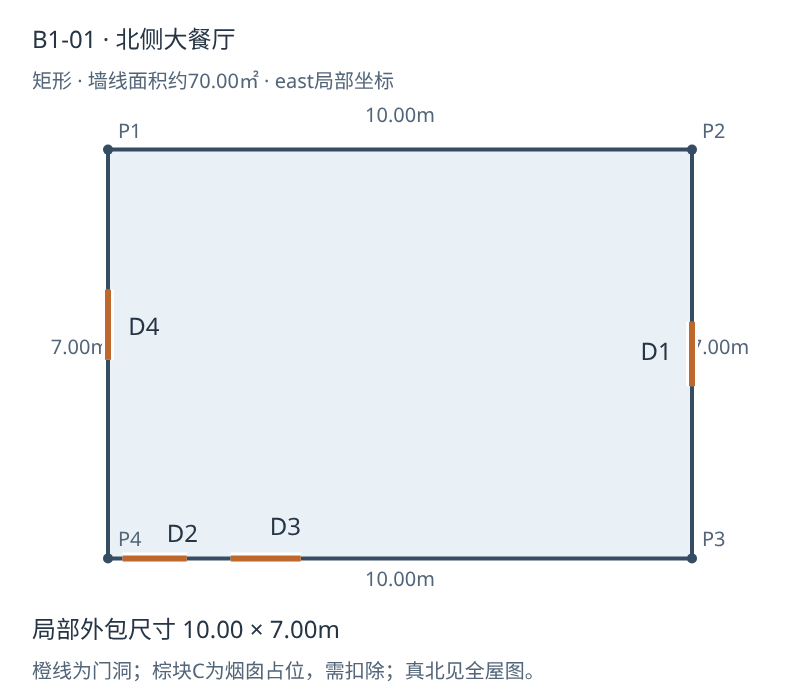

- 楼层：−1层：临湖下层；局部框架：`east`；形状：矩形。
- 墙线面积约 70.00㎡；边长依次为 P1-P2=10.000m / P2-P3=7.000m / P3-P4=10.000m / P4-P1=7.000m。
- 局部顶点（米，按P顺序闭合）：P1=(0.0000, -4.5000)；P2=(10.0000, -4.5000)；P3=(10.0000, 2.5000)；P4=(-0.0000, 2.5000)。
- 全局顶点X/Z（米）：P1=(6.3353, -8.0467)；P2=(15.9946, -10.6349)；P3=(17.8063, -3.8734)；P4=(8.1470, -1.2852)。
- 优先占用临湖北段，约70㎡工作值；承接旧工人食堂的容量，现作主楼餐厅。东门接旧平院，新增西北侧外门接后勤步道；南侧门直通厨房，西南侧通主人用餐短廊。
- 东翼−1层按南—中—北分带，本室占临湖北段，保留旧工人食堂的较大容量。
- 西北侧新外门接室外后勤步道；南门直接通厨房，东门接旧平院。
- 主人从靠主体的B梯沿西侧短廊入餐厅，不穿厨房、杂物或卸货点。

| 门洞 | 所在边 | 全局中心X/Z m | 当前宽m | 当前通向 |
|---|---|---|---|---|
| D1 | P2-P3 | 16.900, -7.254 | 1.100 | OUTSIDE_OR_UNMODELED 室外或未建模空间 |
| D2 | P3-P4 | 8.920, -1.492 | 1.100 | B1-02 主人用餐短廊 |
| D3 | P3-P4 | 10.755, -1.984 | 1.200 | B1-03 中段西 · 厨房 |
| D4 | P4-P1 | 7.112, -5.149 | 1.200 | OUTSIDE_OR_UNMODELED 室外或未建模空间 |

### B1-02 主人用餐短廊

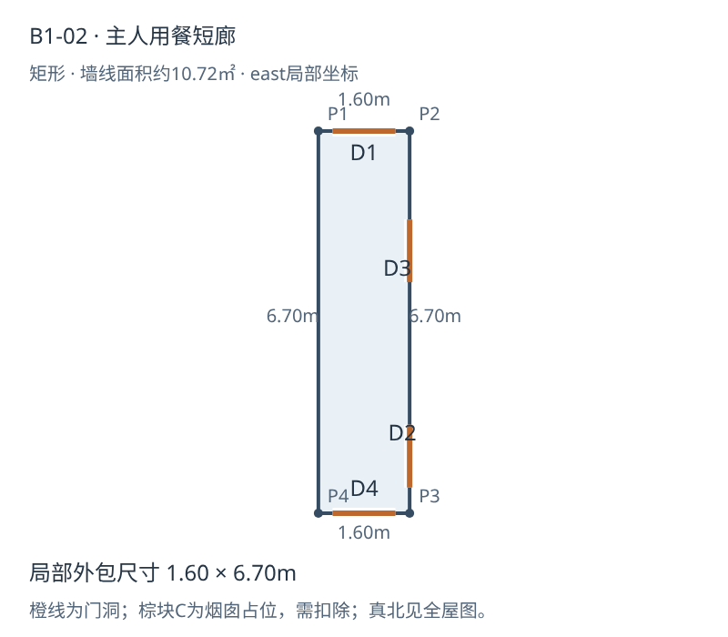

- 楼层：−1层：临湖下层；局部框架：`east`；形状：矩形。
- 墙线面积约 10.72㎡；边长依次为 P1-P2=1.600m / P2-P3=6.700m / P3-P4=1.600m / P4-P1=6.700m。
- 局部顶点（米，按P顺序闭合）：P1=(-0.0000, 2.5000)；P2=(1.6000, 2.5000)；P3=(1.6000, 9.2000)；P4=(0.0000, 9.2000)。
- 全局顶点X/Z（米）：P1=(8.1470, -1.2852)；P2=(9.6925, -1.6993)；P3=(11.4266, 4.7724)；P4=(9.8811, 5.1865)。
- B梯下楼后沿此直进餐厅，不穿厨房、杂物间或卸货点。

| 门洞 | 所在边 | 全局中心X/Z m | 当前宽m | 当前通向 |
|---|---|---|---|---|
| D1 | P1-P2 | 8.920, -1.492 | 1.100 | B1-01 北侧大餐厅 |
| D2 | P2-P3 | 11.168, 3.807 | 1.100 | B1-05 后侧服务短廊 |
| D3 | P2-P3 | 10.236, 0.329 | 1.100 | B1-03 中段西 · 厨房 |
| D4 | P3-P4 | 10.654, 4.979 | 1.100 | B1-06 B 主人餐厅梯 |

### B1-03 中段西 · 厨房

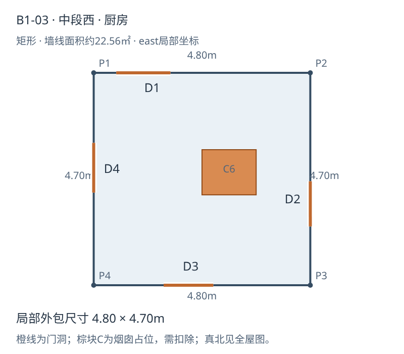

- 楼层：−1层：临湖下层；局部框架：`east`；形状：矩形。
- 墙线面积约 22.56㎡；边长依次为 P1-P2=4.800m / P2-P3=4.700m / P3-P4=4.800m / P4-P1=4.700m。
- 局部顶点（米，按P顺序闭合）：P1=(1.6000, 2.5000)；P2=(6.4000, 2.5000)；P3=(6.4000, 7.2000)；P4=(1.6000, 7.2000)。
- 全局顶点X/Z（米）：P1=(9.6925, -1.6993)；P2=(14.3290, -2.9416)；P3=(15.5454, 1.5982)；P4=(10.9090, 2.8406)。
- 位于东翼中段偏西；北门可直接送餐，西门接后勤外部联系。
- 位于东翼中段偏西，北门直接通北侧大餐厅；并非中央主体下挖出的厨房。

| 门洞 | 所在边 | 全局中心X/Z m | 当前宽m | 当前通向 |
|---|---|---|---|---|
| D1 | P1-P2 | 10.755, -1.984 | 1.200 | B1-01 北侧大餐厅 |
| D2 | P2-P3 | 15.079, -0.140 | 1.000 | B1-04 中段东 · 杂物间 |
| D3 | P3-P4 | 12.937, 2.297 | 1.100 | B1-05 后侧服务短廊 |
| D4 | P4-P1 | 10.236, 0.329 | 1.100 | B1-02 主人用餐短廊 |

### B1-04 中段东 · 杂物间

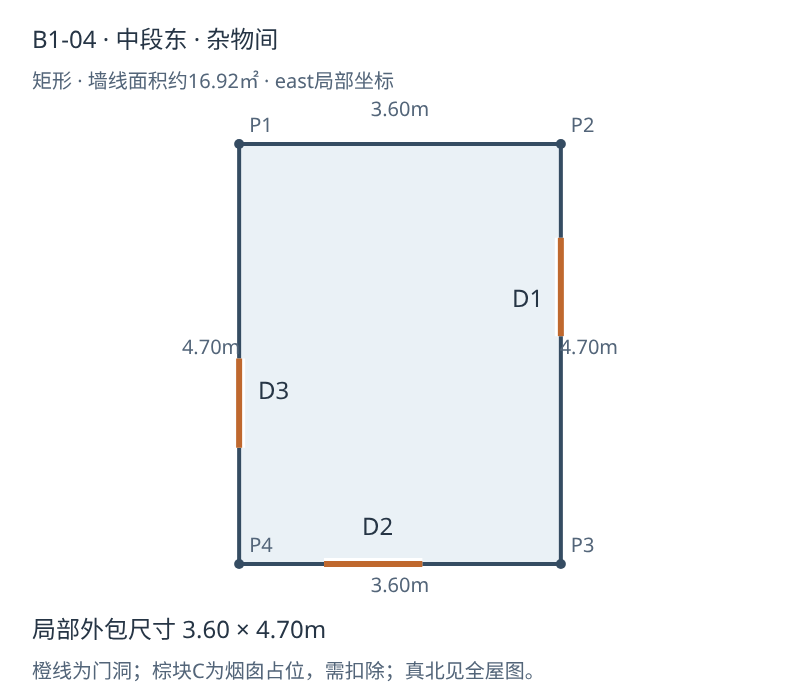

- 楼层：−1层：临湖下层；局部框架：`east`；形状：矩形。
- 墙线面积约 16.92㎡；边长依次为 P1-P2=3.600m / P2-P3=4.700m / P3-P4=3.600m / P4-P1=4.700m。
- 局部顶点（米，按P顺序闭合）：P1=(6.4000, 2.5000)；P2=(10.0000, 2.5000)；P3=(10.0000, 7.2000)；P4=(6.4000, 7.2000)。
- 全局顶点X/Z（米）：P1=(14.3290, -2.9416)；P2=(17.8063, -3.8734)；P3=(19.0228, 0.6665)；P4=(15.5454, 1.5982)。
- 原柴房／灶间燃料与杂物储藏，西门直接进厨房添柴，东门经收货间接卸货点；现代转为杂物间。
- 原柴房，西侧直通厨房添柴；东侧经收货间、卸货边接作业场院。现代保留杂物用途。

| 门洞 | 所在边 | 全局中心X/Z m | 当前宽m | 当前通向 |
|---|---|---|---|---|
| D1 | P2-P3 | 18.220, -2.328 | 1.100 | B1-10 后加收货间 |
| D2 | P3-P4 | 16.994, 1.210 | 1.100 | B1-05 后侧服务短廊 |
| D3 | P4-P1 | 15.079, -0.140 | 1.000 | B1-03 中段西 · 厨房 |

### B1-05 后侧服务短廊

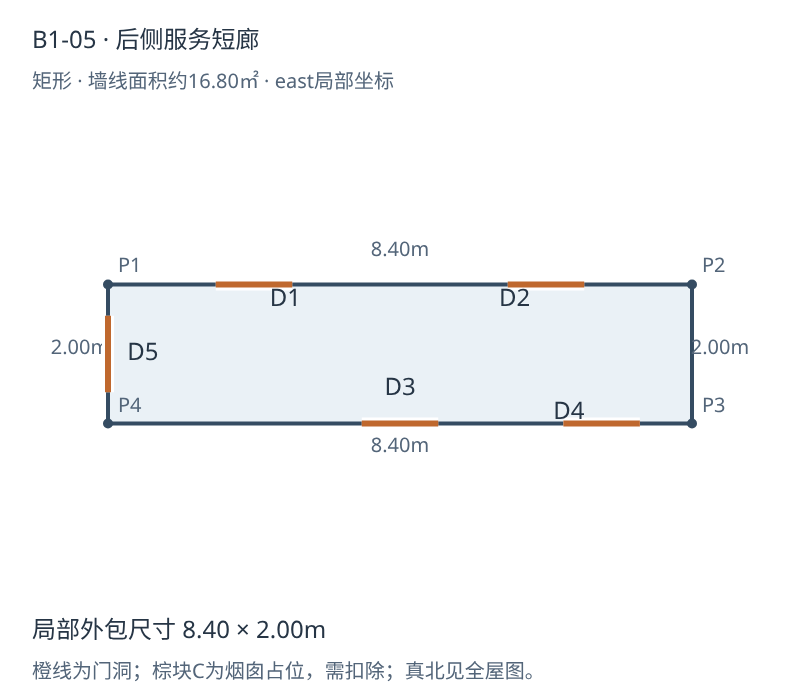

- 楼层：−1层：临湖下层；局部框架：`east`；形状：矩形。
- 墙线面积约 16.80㎡；边长依次为 P1-P2=8.400m / P2-P3=2.000m / P3-P4=8.400m / P4-P1=2.000m。
- 局部顶点（米，按P顺序闭合）：P1=(1.6000, 7.2000)；P2=(10.0000, 7.2000)；P3=(10.0000, 9.2000)；P4=(1.6000, 9.2000)。
- 全局顶点X/Z（米）：P1=(10.9090, 2.8406)；P2=(19.0228, 0.6665)；P3=(19.5404, 2.5983)；P4=(11.4266, 4.7724)。
- 厨房、杂物、地窖和辅助房间的服务联系；主人可在更西侧走独立短廊。

| 门洞 | 所在边 | 全局中心X/Z m | 当前宽m | 当前通向 |
|---|---|---|---|---|
| D1 | P1-P2 | 12.937, 2.297 | 1.100 | B1-03 中段西 · 厨房 |
| D2 | P1-P2 | 16.994, 1.210 | 1.100 | B1-04 中段东 · 杂物间 |
| D3 | P3-P4 | 15.483, 3.685 | 1.100 | B1-07 南侧埋土地窖 |
| D4 | P3-P4 | 18.285, 2.935 | 1.100 | B1-08 餐具／备餐 |
| D5 | P4-P1 | 11.168, 3.807 | 1.100 | B1-02 主人用餐短廊 |

### B1-06 B 主人餐厅梯

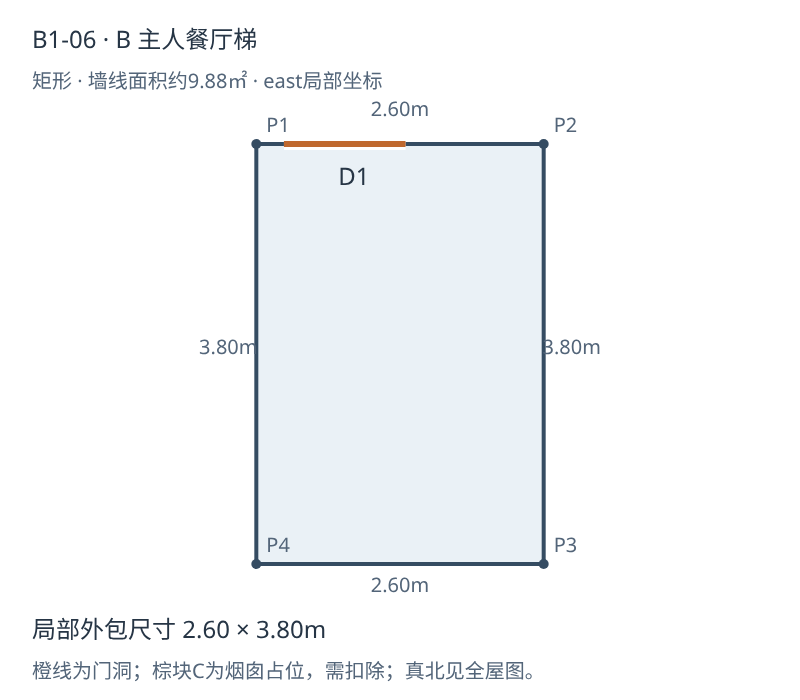

- 楼层：−1层：临湖下层；局部框架：`east`；形状：矩形。
- 墙线面积约 9.88㎡；边长依次为 P1-P2=2.600m / P2-P3=3.800m / P3-P4=2.600m / P4-P1=3.800m。
- 局部顶点（米，按P顺序闭合）：P1=(0.0000, 9.2000)；P2=(2.6000, 9.2000)；P3=(2.6000, 13.0000)；P4=(0.0000, 13.0000)。
- 全局顶点X/Z（米）：P1=(9.8811, 5.1865)；P2=(12.3925, 4.5136)；P3=(13.3761, 8.1841)；P4=(10.8646, 8.8570)。
- 折返双跑楼梯，下层西侧开放口中心u0.8接主人用餐短廊，无门扇。下层平台在短廊内，南端半层平台转向东跑上楼；与上层东北开放口错开。不在踏步端画内开门。

| 门洞 | 所在边 | 全局中心X/Z m | 当前宽m | 当前通向 |
|---|---|---|---|---|
| D1 | P1-P2 | 10.654, 4.979 | 1.100 | B1-02 主人用餐短廊 |

### B1-07 南侧埋土地窖

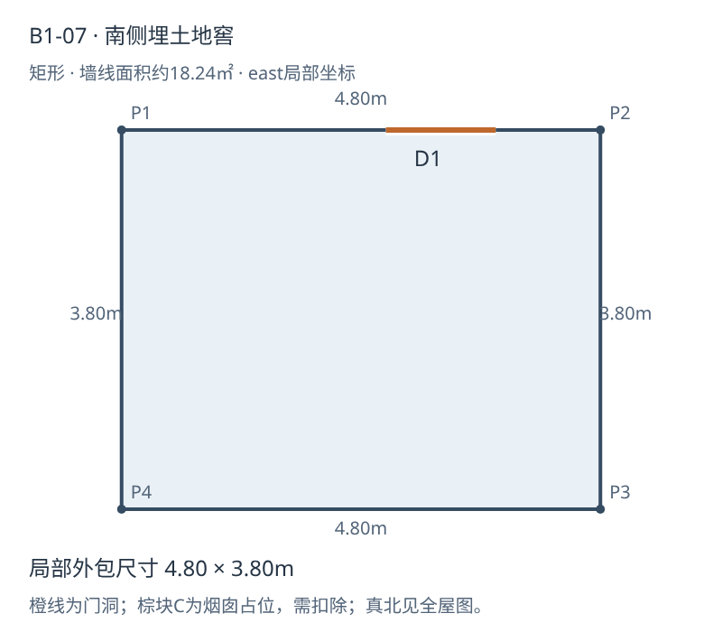

- 楼层：−1层：临湖下层；局部框架：`east`；形状：矩形。
- 墙线面积约 18.24㎡；边长依次为 P1-P2=4.800m / P2-P3=3.800m / P3-P4=4.800m / P4-P1=3.800m。
- 局部顶点（米，按P顺序闭合）：P1=(2.6000, 9.2000)；P2=(7.4000, 9.2000)；P3=(7.4000, 13.0000)；P4=(2.6000, 13.0000)。
- 全局顶点X/Z（米）：P1=(12.3925, 4.5136)；P2=(17.0290, 3.2713)；P3=(18.0125, 6.9418)；P4=(13.3761, 8.1841)。
- 保留在南侧靠山的地下部分，无对外露明房间或装卸门。
- 东翼南侧靠山埋土，无露明外门；不是把全楼−1层都画成地下室。

| 门洞 | 所在边 | 全局中心X/Z m | 当前宽m | 当前通向 |
|---|---|---|---|---|
| D1 | P1-P2 | 15.483, 3.685 | 1.100 | B1-05 后侧服务短廊 |

### B1-08 餐具／备餐

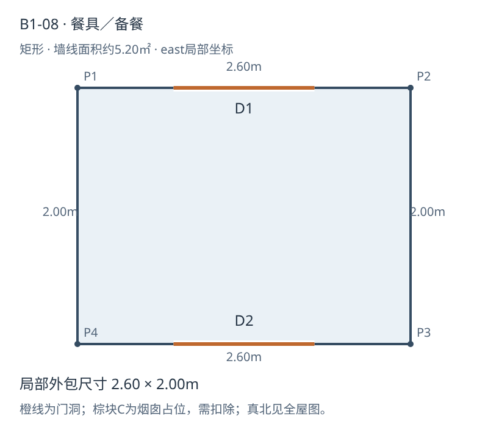

- 楼层：−1层：临湖下层；局部框架：`east`；形状：矩形。
- 墙线面积约 5.20㎡；边长依次为 P1-P2=2.600m / P2-P3=2.000m / P3-P4=2.600m / P4-P1=2.000m。
- 局部顶点（米，按P顺序闭合）：P1=(7.4000, 9.2000)；P2=(10.0000, 9.2000)；P3=(10.0000, 11.2000)；P4=(7.4000, 11.2000)。
- 全局顶点X/Z（米）：P1=(17.0290, 3.2713)；P2=(19.5404, 2.5983)；P3=(20.0580, 4.5302)；P4=(17.5466, 5.2031)。
- 餐具与出餐辅助空间。

| 门洞 | 所在边 | 全局中心X/Z m | 当前宽m | 当前通向 |
|---|---|---|---|---|
| D1 | P1-P2 | 18.285, 2.935 | 1.100 | B1-05 后侧服务短廊 |
| D2 | P3-P4 | 18.802, 4.867 | 1.100 | B1-09 餐厅附属间 · 用途待定 |

### B1-09 餐厅附属间 · 用途待定

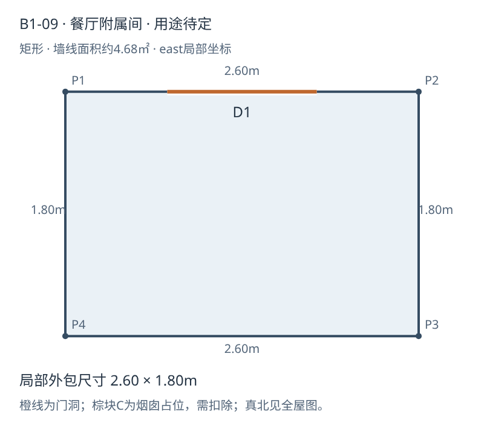

- 楼层：−1层：临湖下层；局部框架：`east`；形状：矩形。
- 墙线面积约 4.68㎡；边长依次为 P1-P2=2.600m / P2-P3=1.800m / P3-P4=2.600m / P4-P1=1.800m。
- 局部顶点（米，按P顺序闭合）：P1=(7.4000, 11.2000)；P2=(10.0000, 11.2000)；P3=(10.0000, 13.0000)；P4=(7.4000, 13.0000)。
- 全局顶点X/Z（米）：P1=(17.5466, 5.2031)；P2=(20.0580, 4.5302)；P3=(20.5239, 6.2688)；P4=(18.0125, 6.9418)。
- 取消原餐厅WC功能，东翼不设厕所；保留原轮廓作待定附属空间，暂不重排备餐隔断。
- 原餐厅WC功能取消，东翼不设厕所；保留轮廓暂待安排附属用途，不自行补马桶。

| 门洞 | 所在边 | 全局中心X/Z m | 当前宽m | 当前通向 |
|---|---|---|---|---|
| D1 | P1-P2 | 18.802, 4.867 | 1.100 | B1-08 餐具／备餐 |

### B1-10 后加收货间

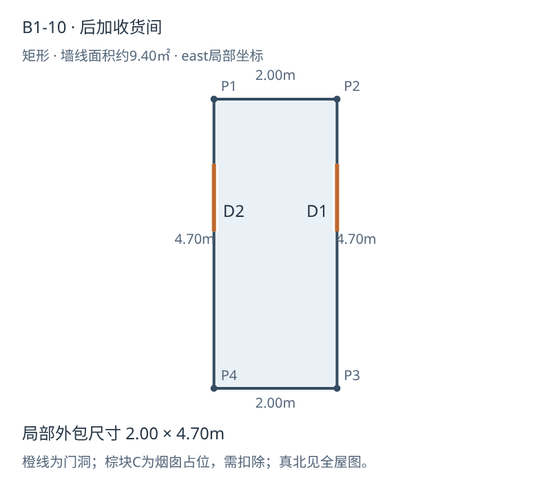

- 楼层：−1层：临湖下层；局部框架：`east`；形状：矩形。
- 墙线面积约 9.40㎡；边长依次为 P1-P2=2.000m / P2-P3=4.700m / P3-P4=2.000m / P4-P1=4.700m。
- 局部顶点（米，按P顺序闭合）：P1=(10.0000, 2.5000)；P2=(12.0000, 2.5000)；P3=(12.0000, 7.2000)；P4=(10.0000, 7.2000)。
- 全局顶点X/Z（米）：P1=(17.8063, -3.8734)；P2=(19.7382, -4.3910)；P3=(20.9546, 0.1488)；P4=(19.0228, 0.6665)。
- 汽车时代向东加出的收货缓冲，西通杂物间，东门到高差卸货边。

| 门洞 | 所在边 | 全局中心X/Z m | 当前宽m | 当前通向 |
|---|---|---|---|---|
| D1 | P2-P3 | 20.152, -2.845 | 1.100 | OUTSIDE_OR_UNMODELED 室外或未建模空间 |
| D2 | P4-P1 | 18.220, -2.328 | 1.100 | B1-04 中段东 · 杂物间 |

### B1-11 季节用品／维修库

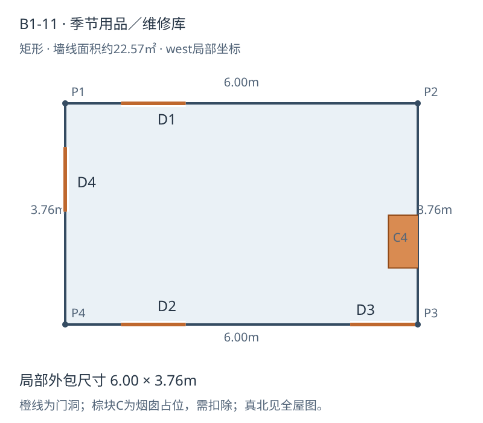

- 楼层：−1层：临湖下层；局部框架：`west`；形状：矩形。
- 墙线面积约 22.57㎡；边长依次为 P1-P2=6.000m / P2-P3=3.761m / P3-P4=6.000m / P4-P1=3.761m。
- 局部顶点（米，按P顺序闭合）：P1=(-18.4000, -8.1739)；P2=(-12.4000, -8.1739)；P3=(-12.4000, -4.4126)；P4=(-18.4000, -4.4126)。
- 全局顶点X/Z（米）：P1=(-22.0011, -6.6449)；P2=(-16.0922, -5.6030)；P3=(-16.7454, -1.8988)；P4=(-22.6542, -2.9407)。
- 保留最西侧库房、室外门和影院维护门；卧室不作为库房或影院的穿行空间。

| 门洞 | 所在边 | 全局中心X/Z m | 当前宽m | 当前通向 |
|---|---|---|---|---|
| D1 | P1-P2 | -20.524, -6.384 | 1.100 | OUTSIDE_OR_UNMODELED 室外或未建模空间 |
| D2 | P3-P4 | -21.177, -2.680 | 1.100 | B1-15 C 西侧服务梯 |
| D3 | P3-P4 | -17.336, -2.003 | 1.100 | B1-16 下层家务前厅 |
| D4 | P4-P1 | -22.226, -5.372 | 1.100 | X-02 放映厅：北端低台 |

### B1-12 锅炉工房／值守卧室

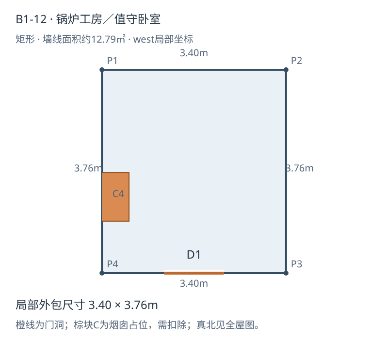

- 楼层：−1层：临湖下层；局部框架：`west`；形状：矩形。
- 墙线面积约 12.79㎡；边长依次为 P1-P2=3.400m / P2-P3=3.761m / P3-P4=3.400m / P4-P1=3.761m。
- 局部顶点（米，按P顺序闭合）：P1=(-12.4000, -8.1739)；P2=(-9.0000, -8.1739)；P3=(-9.0000, -4.4126)；P4=(-12.4000, -4.4126)。
- 全局顶点X/Z（米）：P1=(-16.0922, -5.6030)；P2=(-12.7439, -5.0126)；P3=(-13.3970, -1.3084)；P4=(-16.7454, -1.8988)。
- 原下层女仆房改为锅炉工居住和值守卧室，北侧露明采光、独立走廊门；不是锅炉或蒸汽机操作间，现可作维修值守房。女仆房仅保留1层一间。

| 门洞 | 所在边 | 全局中心X/Z m | 当前宽m | 当前通向 |
|---|---|---|---|---|
| D1 | P3-P4 | -15.071, -1.604 | 1.100 | B1-16 下层家务前厅 |

### B1-13 下层洗漱／WC

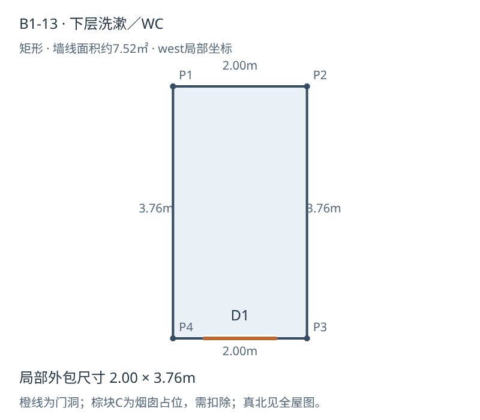

- 楼层：−1层：临湖下层；局部框架：`west`；形状：矩形。
- 墙线面积约 7.52㎡；边长依次为 P1-P2=2.000m / P2-P3=3.761m / P3-P4=2.000m / P4-P1=3.761m。
- 局部顶点（米，按P顺序闭合）：P1=(-9.0000, -8.1739)；P2=(-7.0000, -8.1739)；P3=(-7.0000, -4.4126)；P4=(-9.0000, -4.4126)。
- 全局顶点X/Z（米）：P1=(-12.7439, -5.0126)；P2=(-10.7743, -4.6653)；P3=(-11.4274, -0.9611)；P4=(-13.3970, -1.3084)。
- 为下层卧室提供同层洗漱和如厕条件。

| 门洞 | 所在边 | 全局中心X/Z m | 当前宽m | 当前通向 |
|---|---|---|---|---|
| D1 | P3-P4 | -12.412, -1.135 | 1.100 | B1-16 下层家务前厅 |

### B1-14 下层布草储藏

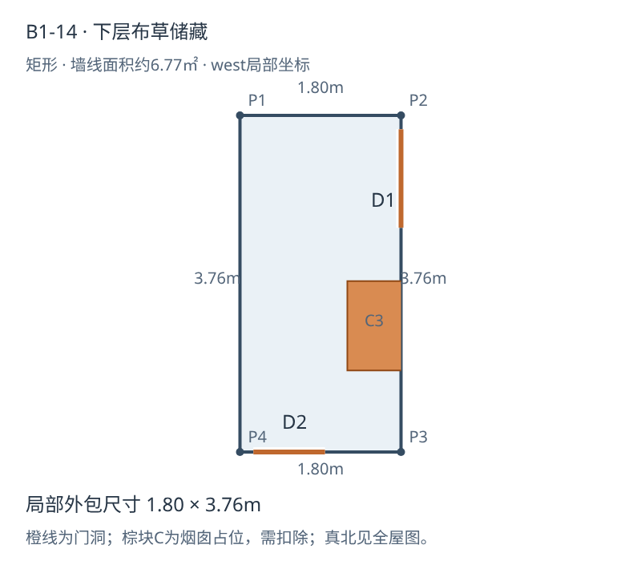

- 楼层：−1层：临湖下层；局部框架：`west`；形状：矩形。
- 墙线面积约 6.77㎡；边长依次为 P1-P2=1.800m / P2-P3=3.761m / P3-P4=1.800m / P4-P1=3.761m。
- 局部顶点（米，按P顺序闭合）：P1=(-7.0000, -8.1739)；P2=(-5.2000, -8.1739)；P3=(-5.2000, -4.4126)；P4=(-7.0000, -4.4126)。
- 全局顶点X/Z（米）：P1=(-10.7743, -4.6653)；P2=(-9.0016, -4.3527)；P3=(-9.6548, -0.6485)；P4=(-11.4274, -0.9611)。
- 在卧室、洗漱区和设备间之间保留家务储物空间。

| 门洞 | 所在边 | 全局中心X/Z m | 当前宽m | 当前通向 |
|---|---|---|---|---|
| D1 | P2-P3 | -9.124, -3.658 | 1.100 | B1-17 旧锅炉房／供热机房 |
| D2 | P3-P4 | -10.886, -0.866 | 0.800 | B1-16 下层家务前厅 |

### B1-15 C 西侧服务梯

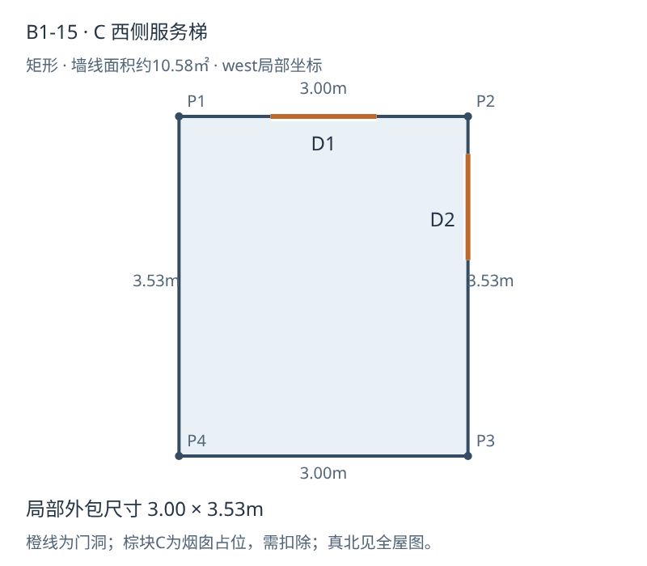

- 楼层：−1层：临湖下层；局部框架：`west`；形状：矩形。
- 墙线面积约 10.58㎡；边长依次为 P1-P2=3.000m / P2-P3=3.526m / P3-P4=3.000m / P4-P1=3.526m。
- 局部顶点（米，按P顺序闭合）：P1=(-18.4000, -4.4126)；P2=(-15.4000, -4.4126)；P3=(-15.4000, -0.8863)；P4=(-18.4000, -0.8863)。
- 全局顶点X/Z（米）：P1=(-22.6542, -2.9407)；P2=(-19.6998, -2.4197)；P3=(-20.3121, 1.0530)；P4=(-23.2666, 0.5320)。
- 与1层最西端楼梯垂直对齐；北侧连库房内通道和室外门。

| 门洞 | 所在边 | 全局中心X/Z m | 当前宽m | 当前通向 |
|---|---|---|---|---|
| D1 | P1-P2 | -21.177, -2.680 | 1.100 | B1-11 季节用品／维修库 |
| D2 | P2-P3 | -19.863, -1.494 | 1.100 | B1-16 下层家务前厅 |

### B1-16 下层家务前厅

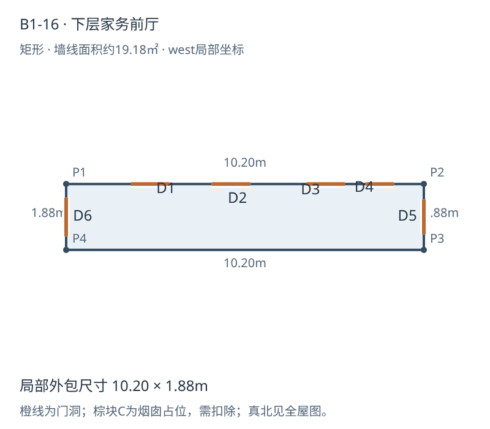

- 楼层：−1层：临湖下层；局部框架：`west`；形状：矩形。
- 墙线面积约 19.18㎡；边长依次为 P1-P2=10.200m / P2-P3=1.881m / P3-P4=10.200m / P4-P1=1.881m。
- 局部顶点（米，按P顺序闭合）：P1=(-15.4000, -4.4126)；P2=(-5.2000, -4.4126)；P3=(-5.2000, -2.5319)；P4=(-15.4000, -2.5319)。
- 全局顶点X/Z（米）：P1=(-19.6998, -2.4197)；P2=(-9.6548, -0.6485)；P3=(-9.9813, 1.2036)；P4=(-20.0264, -0.5676)。
- 楼梯到库房的缓冲通路；不穿主体。

| 门洞 | 所在边 | 全局中心X/Z m | 当前宽m | 当前通向 |
|---|---|---|---|---|
| D1 | P1-P2 | -17.336, -2.003 | 1.100 | B1-11 季节用品／维修库 |
| D2 | P1-P2 | -15.071, -1.604 | 1.100 | B1-12 锅炉工房／值守卧室 |
| D3 | P1-P2 | -12.412, -1.135 | 1.100 | B1-13 下层洗漱／WC |
| D4 | P1-P2 | -10.886, -0.866 | 0.800 | B1-14 下层布草储藏 |
| D5 | P2-P3 | -9.818, 0.278 | 1.000 | B1-17 旧锅炉房／供热机房 |
| D6 | P4-P1 | -19.863, -1.494 | 1.100 | B1-15 C 西侧服务梯 |

### B1-17 旧锅炉房／供热机房

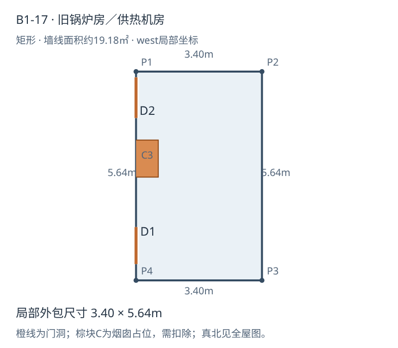

- 楼层：−1层：临湖下层；局部框架：`west`；形状：矩形。
- 墙线面积约 19.18㎡；边长依次为 P1-P2=3.400m / P2-P3=5.642m / P3-P4=3.400m / P4-P1=5.642m。
- 局部顶点（米，按P顺序闭合）：P1=(-5.2000, -8.1739)；P2=(-1.8000, -8.1739)；P3=(-1.8000, -2.5319)；P4=(-5.2000, -2.5319)。
- 全局顶点X/Z（米）：P1=(-9.0016, -4.3527)；P2=(-5.6533, -3.7623)；P3=(-6.6330, 1.7940)；P4=(-9.9813, 1.2036)。
- C3旁锅炉房向南延长至下层家务前厅尽头，新增西侧端门直接入机房；不穿布草储藏。南侧可能局部靠土，排水与结构另核；东端不侵入主楼地基。1890年代试装蒸汽锅炉＋往复式蒸汽机＋直流发电机，兼顾换热供暖和热水；机组占位待核；发电机退役后同楼整合电源转换/变配电独立隔间，锅炉专供热，未画隔间尺寸，不在锅炉工卧室内放机器。
- 东端已缩退在中央主楼实心地基西侧；不得向主楼下方延伸。

| 门洞 | 所在边 | 全局中心X/Z m | 当前宽m | 当前通向 |
|---|---|---|---|---|
| D1 | P4-P1 | -9.818, 0.278 | 1.000 | B1-16 下层家务前厅 |
| D2 | P4-P1 | -9.124, -3.658 | 1.100 | B1-14 下层布草储藏 |

### L2-01 备用卧室一

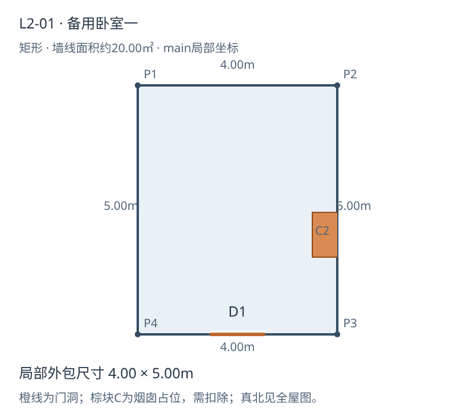

- 楼层：2层：中央主体上层；局部框架：`main`；形状：矩形。
- 墙线面积约 20.00㎡；边长依次为 P1-P2=4.000m / P2-P3=5.000m / P3-P4=4.000m / P4-P1=5.000m。
- 局部顶点（米，按P顺序闭合）：P1=(-5.3000, -3.7000)；P2=(-1.3000, -3.7000)；P3=(-1.3000, 1.3000)；P4=(-5.3000, 1.3000)。
- 全局顶点X/Z（米）：P1=(-5.3000, -3.7000)；P2=(-1.3000, -3.7000)；P3=(-1.3000, 1.3000)；P4=(-5.3000, 1.3000)。
- 原家族卧室，较大的一间。

| 门洞 | 所在边 | 全局中心X/Z m | 当前宽m | 当前通向 |
|---|---|---|---|---|
| D1 | P3-P4 | -3.300, 1.300 | 1.100 | L2-04 上层短走廊 |

### L2-02 备用卧室二

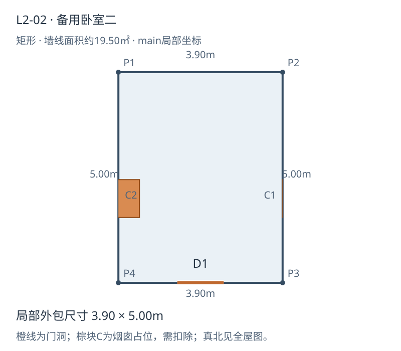

- 楼层：2层：中央主体上层；局部框架：`main`；形状：矩形。
- 墙线面积约 19.50㎡；边长依次为 P1-P2=3.900m / P2-P3=5.000m / P3-P4=3.900m / P4-P1=5.000m。
- 局部顶点（米，按P顺序闭合）：P1=(-1.3000, -3.7000)；P2=(2.6000, -3.7000)；P3=(2.6000, 1.3000)；P4=(-1.3000, 1.3000)。
- 全局顶点X/Z（米）：P1=(-1.3000, -3.7000)；P2=(2.6000, -3.7000)；P3=(2.6000, 1.3000)；P4=(-1.3000, 1.3000)。
- 原家族卧室。

| 门洞 | 所在边 | 全局中心X/Z m | 当前宽m | 当前通向 |
|---|---|---|---|---|
| D1 | P3-P4 | 0.650, 1.300 | 1.100 | L2-04 上层短走廊 |

### L2-03 备用卧室三

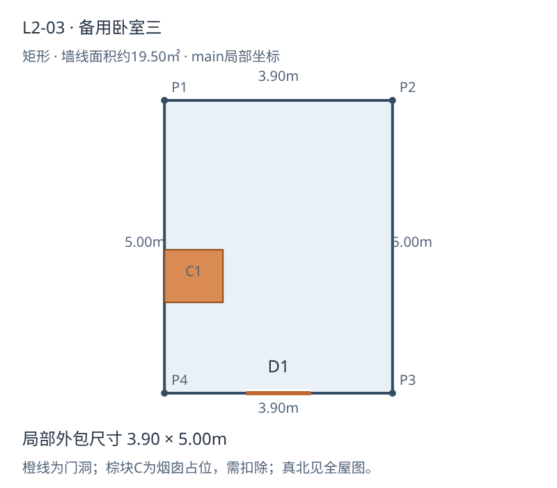

- 楼层：2层：中央主体上层；局部框架：`main`；形状：矩形。
- 墙线面积约 19.50㎡；边长依次为 P1-P2=3.900m / P2-P3=5.000m / P3-P4=3.900m / P4-P1=5.000m。
- 局部顶点（米，按P顺序闭合）：P1=(2.6000, -3.7000)；P2=(6.5000, -3.7000)；P3=(6.5000, 1.3000)；P4=(2.6000, 1.3000)。
- 全局顶点X/Z（米）：P1=(2.6000, -3.7000)；P2=(6.5000, -3.7000)；P3=(6.5000, 1.3000)；P4=(2.6000, 1.3000)。
- 原家族卧室。

| 门洞 | 所在边 | 全局中心X/Z m | 当前宽m | 当前通向 |
|---|---|---|---|---|
| D1 | P3-P4 | 4.550, 1.300 | 1.100 | L2-04 上层短走廊 |

### L2-04 上层短走廊

- 楼层：2层：中央主体上层；局部框架：`main`；形状：矩形。
- 墙线面积约 28.32㎡；边长依次为 P1-P2=11.800m / P2-P3=2.400m / P3-P4=11.800m / P4-P1=2.400m。
- 局部顶点（米，按P顺序闭合）：P1=(-5.3000, 1.3000)；P2=(6.5000, 1.3000)；P3=(6.5000, 3.7000)；P4=(-5.3000, 3.7000)。
- 全局顶点X/Z（米）：P1=(-5.3000, 1.3000)；P2=(6.5000, 1.3000)；P3=(6.5000, 3.7000)；P4=(-5.3000, 3.7000)。
- 各卧室分别开门，不穿房。

| 门洞 | 所在边 | 全局中心X/Z m | 当前宽m | 当前通向 |
|---|---|---|---|---|
| D1 | P1-P2 | -3.300, 1.300 | 1.100 | L2-01 备用卧室一 |
| D2 | P1-P2 | 0.650, 1.300 | 1.100 | L2-02 备用卧室二 |
| D3 | P1-P2 | 4.550, 1.300 | 1.100 | L2-03 备用卧室三 |
| D4 | P3-P4 | -4.200, 3.700 | 1.100 | L2-05 独立浴室 |
| D5 | P3-P4 | -0.800, 3.700 | 1.100 | L2-06 A 楼梯／家庭厅 |
| D6 | P3-P4 | 2.650, 3.700 | 1.100 | L2-07 布草／衣物 |
| D7 | P3-P4 | 5.150, 3.700 | 1.100 | L2-08 共用浴室 |

### L2-05 独立浴室

- 楼层：2层：中央主体上层；局部框架：`main`；形状：矩形。
- 墙线面积约 8.36㎡；边长依次为 P1-P2=2.200m / P2-P3=3.800m / P3-P4=2.200m / P4-P1=3.800m。
- 局部顶点（米，按P顺序闭合）：P1=(-5.3000, 3.7000)；P2=(-3.1000, 3.7000)；P3=(-3.1000, 7.5000)；P4=(-5.3000, 7.5000)。
- 全局顶点X/Z（米）：P1=(-5.3000, 3.7000)；P2=(-3.1000, 3.7000)；P3=(-3.1000, 7.5000)；P4=(-5.3000, 7.5000)。
- 较大备用卧室使用；仅洗浴，不含厕所。

| 门洞 | 所在边 | 全局中心X/Z m | 当前宽m | 当前通向 |
|---|---|---|---|---|
| D1 | P1-P2 | -4.200, 3.700 | 1.100 | L2-04 上层短走廊 |

### L2-06 A 楼梯／家庭厅

- 楼层：2层：中央主体上层；局部框架：`main`；形状：矩形。
- 墙线面积约 17.48㎡；边长依次为 P1-P2=4.600m / P2-P3=3.800m / P3-P4=4.600m / P4-P1=3.800m。
- 局部顶点（米，按P顺序闭合）：P1=(-3.1000, 3.7000)；P2=(1.5000, 3.7000)；P3=(1.5000, 7.5000)；P4=(-3.1000, 7.5000)。
- 全局顶点X/Z（米）：P1=(-3.1000, 3.7000)；P2=(1.5000, 3.7000)；P3=(1.5000, 7.5000)；P4=(-3.1000, 7.5000)。
- 与主门厅的A楼梯垂直对齐。

| 门洞 | 所在边 | 全局中心X/Z m | 当前宽m | 当前通向 |
|---|---|---|---|---|
| D1 | P1-P2 | -0.800, 3.700 | 1.100 | L2-04 上层短走廊 |

### L2-07 布草／衣物

- 楼层：2层：中央主体上层；局部框架：`main`；形状：矩形。
- 墙线面积约 8.74㎡；边长依次为 P1-P2=2.300m / P2-P3=3.800m / P3-P4=2.300m / P4-P1=3.800m。
- 局部顶点（米，按P顺序闭合）：P1=(1.5000, 3.7000)；P2=(3.8000, 3.7000)；P3=(3.8000, 7.5000)；P4=(1.5000, 7.5000)。
- 全局顶点X/Z（米）：P1=(1.5000, 3.7000)；P2=(3.8000, 3.7000)；P3=(3.8000, 7.5000)；P4=(1.5000, 7.5000)。
- 布草与衣物储藏。

| 门洞 | 所在边 | 全局中心X/Z m | 当前宽m | 当前通向 |
|---|---|---|---|---|
| D1 | P1-P2 | 2.650, 3.700 | 1.100 | L2-04 上层短走廊 |
| D2 | P2-P3 | 3.800, 6.550 | 1.100 | L2-09 收藏整理 |

### L2-08 共用浴室

- 楼层：2层：中央主体上层；局部框架：`main`；形状：矩形。
- 墙线面积约 5.13㎡；边长依次为 P1-P2=2.700m / P2-P3=1.900m / P3-P4=2.700m / P4-P1=1.900m。
- 局部顶点（米，按P顺序闭合）：P1=(3.8000, 3.7000)；P2=(6.5000, 3.7000)；P3=(6.5000, 5.6000)；P4=(3.8000, 5.6000)。
- 全局顶点X/Z（米）：P1=(3.8000, 3.7000)；P2=(6.5000, 3.7000)；P3=(6.5000, 5.6000)；P4=(3.8000, 5.6000)。
- 供其余两间备用卧室洗浴，不含厕所。

| 门洞 | 所在边 | 全局中心X/Z m | 当前宽m | 当前通向 |
|---|---|---|---|---|
| D1 | P1-P2 | 5.150, 3.700 | 1.100 | L2-04 上层短走廊 |

### L2-09 收藏整理

- 楼层：2层：中央主体上层；局部框架：`main`；形状：矩形。
- 墙线面积约 5.13㎡；边长依次为 P1-P2=2.700m / P2-P3=1.900m / P3-P4=2.700m / P4-P1=1.900m。
- 局部顶点（米，按P顺序闭合）：P1=(3.8000, 5.6000)；P2=(6.5000, 5.6000)；P3=(6.5000, 7.5000)；P4=(3.8000, 7.5000)。
- 全局顶点X/Z（米）：P1=(3.8000, 5.6000)；P2=(6.5000, 5.6000)；P3=(6.5000, 7.5000)；P4=(3.8000, 7.5000)。
- 由家庭厅侧门进入；普通藏品整理。
- 当前白模从布草/衣物侧进入；门位可在不改外轮廓、楼梯关系的前提下细化。

| 门洞 | 所在边 | 全局中心X/Z m | 当前宽m | 当前通向 |
|---|---|---|---|---|
| D1 | P4-P1 | 3.800, 6.550 | 1.100 | L2-07 布草／衣物 |

### L1-32 定制空调设备间

- 楼层：1层：主体一层＝东翼二层；局部框架：`west`；形状：矩形。
- 墙线面积约 15.07㎡；边长依次为 P1-P2=3.400m / P2-P3=4.432m / P3-P4=3.400m / P4-P1=4.432m。
- 局部顶点（米，按P顺序闭合）：P1=(-27.4000, 1.6742)；P2=(-24.0000, 1.6742)；P3=(-24.0000, 6.1058)；P4=(-27.4000, 6.1058)。
- 全局顶点X/Z（米）：P1=(-32.5744, 1.4908)；P2=(-29.2261, 2.0812)；P3=(-29.9956, 6.4455)；P4=(-33.3440, 5.8551)。
- 1960年代影院南侧配套，南墙与收藏室外包络对齐，约3.40×4.43m；南门接室外检修/收货坪；与收藏室实墙隔声分隔。舒适空调与片库控温控湿独立分区/回风，机组隔振消声；后期逐步扩展全宅，原水暖保留。室外换热端、管线和负荷另核，不表示单间足容全宅全部机组。

| 门洞 | 所在边 | 全局中心X/Z m | 当前宽m | 当前通向 |
|---|---|---|---|---|
| D1 | P3-P4 | -31.670, 6.150 | 1.100 | OUTSIDE_OR_UNMODELED 室外或未建模空间 |

### L1-33 小胶片收藏室／放映整备

- 楼层：1层：主体一层＝东翼二层；局部框架：`west`；形状：6边形。
- 墙线面积约 17.43㎡；边长依次为 P1-P2=2.600m / P2-P3=4.432m / P3-P4=5.600m / P4-P5=1.970m / P5-P6=3.000m / P6-P1=2.462m。
- 局部顶点（米，按P顺序闭合）：P1=(-21.0000, 1.6742)；P2=(-18.4000, 1.6742)；P3=(-18.4000, 6.1058)；P4=(-24.0000, 6.1058)；P5=(-24.0000, 4.1362)；P6=(-21.0000, 4.1362)。
- 全局顶点X/Z（米）：P1=(-26.2717, 2.6021)；P2=(-23.7112, 3.0536)；P3=(-24.4807, 7.4179)；P4=(-29.9956, 6.4455)；P5=(-29.6536, 4.5058)；P6=(-26.6992, 5.0267)。
- 南门接收博物馆调片，北门通观影门斗；西北角独立放映机房由本室内门进入，热设备不在藏片环境中。收藏/回温整备内部仍需细分，片库独立控温控湿，不向机房借回风。

| 门洞 | 所在边 | 全局中心X/Z m | 当前宽m | 当前通向 |
|---|---|---|---|---|
| D1 | P1-P2 | -24.794, 2.863 | 1.100 | X-04 放映厅：观影门斗 |
| D2 | P3-P4 | -27.238, 6.932 | 1.100 | OUTSIDE_OR_UNMODELED 室外或未建模空间 |
| D3 | P5-P6 | -28.176, 4.766 | 0.900 | L1-34 独立放映机房 |

### L1-34 独立放映机房

- 楼层：1层：主体一层＝东翼二层；局部框架：`west`；形状：矩形。
- 墙线面积约 7.39㎡；边长依次为 P1-P2=3.000m / P2-P3=2.462m / P3-P4=3.000m / P4-P1=2.462m。
- 局部顶点（米，按P顺序闭合）：P1=(-24.0000, 1.6742)；P2=(-21.0000, 1.6742)；P3=(-21.0000, 4.1362)；P4=(-24.0000, 4.1362)。
- 全局顶点X/Z（米）：P1=(-29.2261, 2.0812)；P2=(-26.2717, 2.6021)；P3=(-26.6992, 5.0267)；P4=(-29.6536, 4.5058)。
- 由收藏/整备室的0.90m内门进入，观众厅无设备出入门；不透视隔墙上仅有小型放映窗，机器退在窗后暗室内，观众不直接看到机器。机房独立散热/补风，与胶片存储分开调温控湿。3.0×2.46m为单机/小型设备机房工作值，历史胶片机及检修空间仍需按型号核对，不默认容纳两台35毫米机。

| 门洞 | 所在边 | 全局中心X/Z m | 当前宽m | 当前通向 |
|---|---|---|---|---|
| D1 | P3-P4 | -28.176, 4.766 | 0.900 | L1-33 小胶片收藏室／放映整备 |

### X-01 放映厅：连续跨层主空间

- 楼层：1层：主体一层＝东翼二层；局部框架：`west`；形状：矩形。
- 墙线面积约 88.63㎡；边长依次为 P1-P2=9.000m / P2-P3=9.848m / P3-P4=9.000m / P4-P1=9.848m。
- 局部顶点（米，按P顺序闭合）：P1=(-27.4000, -8.1739)；P2=(-18.4000, -8.1739)；P3=(-18.4000, 1.6742)；P4=(-27.4000, 1.6742)。
- 全局顶点X/Z（米）：P1=(-30.8643, -8.2077)；P2=(-22.0011, -6.6449)；P3=(-23.7112, 3.0536)；P4=(-32.5744, 1.4908)。
- 同一跨层放映空间的轮廓或子区域；X-02地面在−1层，平台和门斗在1层。中间不铺完整楼板。

| 门洞 | 所在边 | 全局中心X/Z m | 当前宽m | 当前通向 |
|---|---|---|---|---|
| D1 | CUSTOM | -23.366, 1.093 | 1.100 | L1-27 西翼唯一贯通走廊 / X-04 放映厅：观影门斗 |
| D2 | CUSTOM | -22.226, -5.372 | 1.100 | B1-11 季节用品／维修库 / X-02 放映厅：北端低台 |

### X-02 放映厅：北端低台

- 楼层：1层：主体一层＝东翼二层；局部框架：`west`；形状：矩形。
- 墙线面积约 16.93㎡；边长依次为 P1-P2=9.000m / P2-P3=1.881m / P3-P4=9.000m / P4-P1=1.881m。
- 局部顶点（米，按P顺序闭合）：P1=(-27.4000, -8.1739)；P2=(-18.4000, -8.1739)；P3=(-18.4000, -6.2932)；P4=(-27.4000, -6.2932)。
- 全局顶点X/Z（米）：P1=(-30.8643, -8.2077)；P2=(-22.0011, -6.6449)；P3=(-22.3277, -4.7928)；P4=(-31.1909, -6.3556)。
- 同一跨层放映空间的轮廓或子区域；X-02地面在−1层，平台和门斗在1层。中间不铺完整楼板。

| 门洞 | 所在边 | 全局中心X/Z m | 当前宽m | 当前通向 |
|---|---|---|---|---|
| D1 | CUSTOM | -22.226, -5.372 | 1.100 | B1-11 季节用品／维修库 |

### X-03 放映厅：1层观影平台

- 楼层：1层：主体一层＝东翼二层；局部框架：`west`；形状：矩形。
- 墙线面积约 17.41㎡；边长依次为 P1-P2=6.800m / P2-P3=2.561m / P3-P4=6.800m / P4-P1=2.561m。
- 局部顶点（米，按P顺序闭合）：P1=(-27.4000, -0.8863)；P2=(-20.6000, -0.8863)；P3=(-20.6000, 1.6742)；P4=(-27.4000, 1.6742)。
- 全局顶点X/Z（米）：P1=(-32.1298, -1.0308)；P2=(-25.4331, 0.1500)；P3=(-25.8778, 2.6716)；P4=(-32.5744, 1.4908)。
- 同一跨层放映空间的轮廓或子区域；X-02地面在−1层，平台和门斗在1层。中间不铺完整楼板。

| 门洞 | 所在边 | 全局中心X/Z m | 当前宽m | 当前通向 |
|---|---|---|---|---|
| D1 | CUSTOM | -25.615, 1.181 | 1.100 | X-04 放映厅：观影门斗 |

### X-04 放映厅：观影门斗

- 楼层：1层：主体一层＝东翼二层；局部框架：`west`；形状：矩形。
- 墙线面积约 5.63㎡；边长依次为 P1-P2=2.200m / P2-P3=2.561m / P3-P4=2.200m / P4-P1=2.561m。
- 局部顶点（米，按P顺序闭合）：P1=(-20.6000, -0.8863)；P2=(-18.4000, -0.8863)；P3=(-18.4000, 1.6742)；P4=(-20.6000, 1.6742)。
- 全局顶点X/Z（米）：P1=(-25.4331, 0.1500)；P2=(-23.2666, 0.5320)；P3=(-23.7112, 3.0536)；P4=(-25.8778, 2.6716)。
- 同一跨层放映空间的轮廓或子区域；X-02地面在−1层，平台和门斗在1层。中间不铺完整楼板。

| 门洞 | 所在边 | 全局中心X/Z m | 当前宽m | 当前通向 |
|---|---|---|---|---|
| D1 | CUSTOM | -24.794, 2.863 | 1.100 | L1-33 小胶片收藏室／放映整备 |
| D2 | CUSTOM | -23.366, 1.093 | 1.100 | L1-27 西翼唯一贯通走廊 |
| D3 | CUSTOM | -25.615, 1.181 | 1.100 | X-03 放映厅：1层观影平台 |

### Y-01 旧码头场院：平进平出

- 楼层：−1层：临湖下层；局部框架：`east`；形状：矩形。
- 墙线面积约 21.60㎡；边长依次为 P1-P2=3.600m / P2-P3=6.000m / P3-P4=3.600m / P4-P1=6.000m。
- 局部顶点（米，按P顺序闭合）：P1=(10.0000, -4.5000)；P2=(13.6000, -4.5000)；P3=(13.6000, 1.5000)；P4=(10.0000, 1.5000)。
- 全局顶点X/Z（米）：P1=(15.9946, -10.6349)；P2=(19.4719, -11.5666)；P3=(21.0248, -5.7711)；P4=(17.5475, -4.8393)。
- 户外作业区。旧平院及卸货边顶面约−3.2m，皮卡低坪约−3.85m，高差0.65m为工作值。

当前无门洞数据；柜带或户外区不据此推定为可进入的独立房间。

### Y-02 后加卸货边

- 楼层：−1层：临湖下层；局部框架：`east`；形状：矩形。
- 墙线面积约 4.80㎡；边长依次为 P1-P2=1.600m / P2-P3=3.000m / P3-P4=1.600m / P4-P1=3.000m。
- 局部顶点（米，按P顺序闭合）：P1=(12.0000, 2.8000)；P2=(13.6000, 2.8000)；P3=(13.6000, 5.8000)；P4=(12.0000, 5.8000)。
- 全局顶点X/Z（米）：P1=(19.8158, -4.1012)；P2=(21.3613, -4.5153)；P3=(22.1377, -1.6176)；P4=(20.5923, -1.2035)。
- 户外作业区。旧平院及卸货边顶面约−3.2m，皮卡低坪约−3.85m，高差0.65m为工作值。

当前无门洞数据；柜带或户外区不据此推定为可进入的独立房间。

### Y-03 皮卡棚下低坪

- 楼层：−1层：临湖下层；局部框架：`east`；形状：矩形。
- 墙线面积约 28.00㎡；边长依次为 P1-P2=7.000m / P2-P3=4.000m / P3-P4=7.000m / P4-P1=4.000m。
- 局部顶点（米，按P顺序闭合）：P1=(13.6000, 2.0000)；P2=(20.6000, 2.0000)；P3=(20.6000, 6.0000)；P4=(13.6000, 6.0000)。
- 全局顶点X/Z（米）：P1=(21.1542, -5.2881)；P2=(27.9157, -7.0998)；P3=(28.9510, -3.2361)；P4=(22.1895, -1.4244)。
- 户外作业区。旧平院及卸货边顶面约−3.2m，皮卡低坪约−3.85m，高差0.65m为工作值。

当前无门洞数据；柜带或户外区不据此推定为可进入的独立房间。

## 后续细化边界

- 这次锁定的是已确认白模的拓扑与粗轮廓。三维墙体剖低、楼梯简化、管线/防水/通风/消防与结构没有施工级设计。
- 门洞表忠实记录当前白模，家具 Agent 不能把“未与室内轮廓配对”自动当作新外门；遇到需求冲突应指出具体房间/边编号。
- 烟囱核心位置以[烟囱预留说明](烟囱核心与房间接入预留.md)及JSON的chimney_cores为准，棕色占位不得当作可摆家具的面积；房间墙线面积未扣除核心。炉具、独立烟道及书架检修继续细化。
- 画室已落位L1-18原梯形家庭起居室：上楼经主门厅/南侧短过厅进入，可由门外返回卧室；洗笔、画架及坐谈位置待单间细排。
- 收藏车库、汽车博物馆、业余机场/机库只作为独立设施候选，未纳入本楼。
- 原始数据见`白模原始几何.json`；可读数据见`房间轮廓数据.json`。本地生成源在`toolchain/scene3d/house/`（不进源码仓）。
